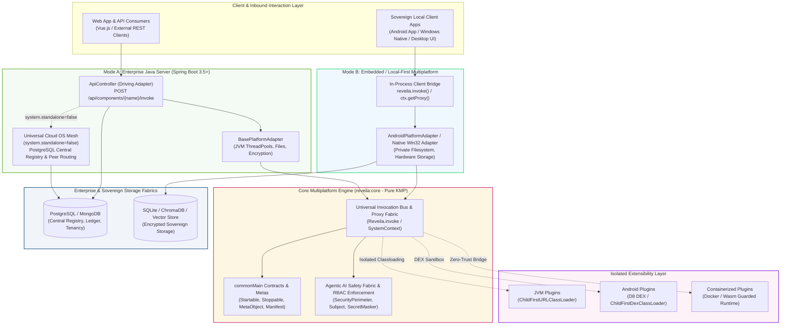

# Reveila-Suite

Reveila-Suite is a cross-platform, multi-tenant **Agentic AI Execution Fabric** and **Universal Cloud Operating System** designed to autonomously discover, orchestrate, and execute complex business logic at scale. Built on a foundation of **Clean Hexagonal Architecture** and a pure **Kotlin Multiplatform (KMP)** core runtime engine, it provides secure, observable, and platform-independent environments for deploying autonomous AI agents that seamlessly interface with core transactional enterprise backbones, elastic distributed cloud clusters, and sovereign edge nodes.

---

## 📑 Table of Contents

- [🏛️ The "Sovereign Mode" Experience](#️-the-sovereign-mode-experience)
- [🛡️ Trust-Boundaries Matrix](#️-trust-boundaries-matrix)
- [🗺️ System Topology & Dual Execution Architecture](#️-system-topology--dual-execution-architecture)
- [🛠️ Technology Stack & Runtime Ecosystem](#️-technology-stack--runtime-ecosystem)
- [🧠 Agentic AI Architecture & Execution Fabric](#-agentic-ai-architecture--execution-fabric)
  - [🔄 The "AI Loop" Stateful Session Management](#-the-ai-loop-stateful-session-management)
  - [🌉 LangChain4j Translation & The Message Chain Pattern](#-langchain4j-translation--the-message-chain-pattern)
  - [📊 Prompt Standardization & Structural Security](#-prompt-standardization--structural-security)
  - [💾 Context Optimization & Memory Footprint Controls](#-context-optimization--memory-footprint-controls)
  - [🚀 Execution Configurations: Personal vs. Enterprise](#-execution-configurations-personal-vs-enterprise)
  - [⚡ High-Precision Context Pipelines (Tool RAG & Knowledge Vault)](#-high-precision-context-pipelines-tool-rag--knowledge-vault)
  - [🔌 API Invocation Contracts](#-api-invocation-contracts)
- [🏗️ Platform Architecture & Extensibility Specification (ADR-0001)](#️-platform-architecture--extensibility-specification-adr-0001)
  - [Core Architectural Pillars & Pure KMP Engine](#2-core-architectural-pillars)
  - [Dual Execution Paradigms: Server Mode vs. Local-First Mode](#23-hexagonal-platform-adapter-port-platformadapter)
  - [Universal Cloud OS: Standalone vs. Clustered Mesh](#2311-the-universal-cloud-operating-system-standalone-vs-clustered-mode-systemstandalone)
  - [Managed Invocation: Proxies and Service Bus](#3-managed-invocation-proxies-and-orchestration)
  - [Third-Party Plugin Specification & Developer Guide](#4-extensibility-architecture-third-party-plugin-specification)
  - [Monorepo Module Directory Structure](#6-monorepo-module-directory-structure)
- [👨‍💻 Platform Author & Principle Executive Advisory](#-platform-author--principle-executive-advisory)

---

## 🏛️ The "Sovereign Mode" Experience

### Your AI Doesn’t Need a Passport. Or a Signal.
Introducing **Reveila Sovereign Mode**—the high-performance enterprise AI agent fabric engineered to execute 100% locally on sovereign edge devices. No forced cloud data pipelines. No network-induced latency bottlenecks. Total operational sovereignty.

### ✈️ The "Flight Mode" Paradox Solved
Most modern AI tools turn into high-latency dependencies or expensive paperweights the moment they lose connection. While other legacy applications stall waiting for slow cloud pipes to register a single command, Reveila is actively processing logic at the edge.

* **Offline System Reasoning:** Executes enterprise workloads natively utilizing high-speed local inference adapters directly on your flagship devices.
* **Zero-Latency Storage Grains:** Instant workspace data streaming and context matching via local vector stores without microsecond structural network lag.
* **The Sovereign Vault:** Total data boundaries. Your proprietary parameters, transaction histories, and workspace contexts remain exclusively inside your isolated local hardware layer.

---

## 🛡️ Trust-Boundaries Matrix

| Security Parameter | The Standard Cloud Way | The Reveila Sovereign Way |
| :--- | :--- | :--- |
| **Data Privacy** | Intercepted, aggregated, and utilized for central foundational training pipelines. | **Strict Sovereignty.** Fully localized context processing. Explicit user boundaries. |
| **Inference Speed** | 500ms–2000ms distributed remote network round-trip overhead. | **Instantaneous Execution.** 5ms–20ms isolated native response windows. |
| **Operational Continuity** | Remote infrastructure outages dictate operational downtime. | **Always On.** Native local execution during deep field transit or secure off-grid loops. |
| **System Authorization** | Software-only toggles vulnerable to remote boundary bypass. | **Hardware Gated.** Biometric-authenticated loops dictate physical verification. |

---

## 🗺️ System Topology & Dual Execution Architecture



---

## 🛠️ Technology Stack & Runtime Ecosystem

| Architectural Layer | Core Technologies & Frameworks | Target Environments |
| :--- | :--- | :--- |
| **Core Multiplatform Engine (`reveila:core`)** | **Kotlin Multiplatform (KMP)**, Kotlin 2.x, Java 17/21 Bytecode, Native C/C++ (`reveila_core.dll`, `.h`, Apple Frameworks), Gradle (Kotlin DSL) | Universal (JVM, Android, Windows, macOS, Linux) |
| **Enterprise Server (Mode A)** | **Spring Boot 3.5.x**, Spring Security, Hibernate/JPA, HikariCP, PostgreSQL (NOTIFY/LISTEN Mesh), H2 | Cloud VMs, Containers, Elastic Kubernetes Clusters |
| **Sovereign Client Runtimes (Mode B)** | **Android ART** (SDK 34+, Android 14+ Security), React Native (Expo SDK), Windows Native (Win32), Node.js | Flagship Mobile, Air-Gapped Workstations |
| **Agentic AI & Inference Engine** | **LangChain4j**, Ollama (Local LLM), OpenAI / Gemini APIs, Prompt Firewalls (Markdown + XML) | Embedded Local Edge & Enterprise Server |
| **Sandboxing & Tool Runtimes** | **Wasmtime** (WebAssembly), Docker Guarded Runtime, Playwright, Xterm.js / node-pty | Isolated Workspaces & Micro-VM Sandboxes |
| **Enterprise & Local Storage Fabrics** | PostgreSQL (Central Registry Ledger), MongoDB, SQLite (Native Extensions), DuckDB, ChromaDB | Distributed Cloud DB & Sovereign Local Vector Stores |

---

## 🧠 Agentic AI Architecture & Execution Fabric

### 🔄 The "AI Loop" Stateful Session Management

Agent activities are grouped into isolated, stateful sessions. These sessions are fully persisted, allowing reasoning states to be suspended, terminated, or resumed at a later timestamp. During an active execution thread, the **Agentic Loop** runs via the following deterministic pattern:

```
[System Instruction + Tool Definitions + User Intent] 
                        │
                        ▼
            [LLM Non-Deterministic Reasoning]
                        │
                        ▼
          [Structured JSON Tool Call Output]
                        │
                        ▼
        [Java Execution & Schema Validation (Host / OS)]
                        │
                        ▼
        [Tool Output Result Matrix Recovers] ─── (Loops back to stabilize)
```

### 🌉 LangChain4j Translation & The Message Chain Pattern

The engine integrates `LangChain4j` to act as an infrastructure abstraction driver layer between core domain interfaces and external inference models (e.g., cloud endpoints like OpenAI/Gemini vs. local targets like Ollama). It manages low-level API serialization, enforces structural Java object mappings from raw model outputs, and permits swapping providers by tweaking single application property definitions.

To preserve accurate reasoning histories across multi-turn execution loops, the system maintains a chronologically ordered state array (`dev.langchain4j.memory.ChatMemory`). The `processLoop()` method in `AgenticFabric.java` explicitly pieces this array together on every turn, injecting four critical discrete roles:

1. **SystemMessage:** Contains core operational instructions, perimeter rules, and tools structured via the Model Context Protocol (MCP).
2. **UserMessage:** The raw incoming intent statement provided by the user.
3. **AiMessage:** Captures the LLM's explicit reasoning steps and generated tool-call parameters.
4. **ToolExecutionResultMessage:** Binds the execution result payload (e.g., PowerShell runtime output or REST data logs) back into the conversation context block.

### 📊 Prompt Standardization & Structural Security

All system instructions and user payloads are assembled utilizing structural **Markdown + XML** markup configurations managed through `Prompt.getBasePrompt()`.

* **Markdown:** Provides macro-level system hierarchies, operational roles, and clear readability sections (`# ROLE`, `# CONTEXT`).
* **XML Tags:** Act as structural "firewalls" surrounding dynamic external data blocks (e.g., `<context_boundary>`), effectively stopping prompt injection attempts from altering target instructions.

#### Format Performance Evaluation

| Architectural Strategy | Core Reasoning Capabilities | Token Asset Footprint | Injection Safety Profiles | Human Auditability |
| :--- | :--- | :--- | :--- | :--- |
| **Plain Text** | Basic Pattern Discovery | Lowest Footprint | Poor Context Isolation | High Clarity |
| **JSON Specifications** | Moderate Logic Parsing | High Token Overhead | Good Structure Parsing | Low Auditing Clarity |
| **Markdown + XML** | **Highest Capability (81.2%)** | **Optimized Efficiency** | **Excellent (Tag Firewalls)** | **High Structural Clarity** |

### 💾 Context Optimization & Memory Footprint Controls

#### Sliding Memory Windows
To prevent memory inflation and escalating token processing latency during long-running tasks, the system implements a runtime truncation strategy. After an execution track passes 10–15 turns, the engine automatically commands a lightweight model tracking step to summarize preceding entries, capturing historical state indicators while freeing block overhead using a defined `MessageWindowChatMemory` configuration:

```java
// How Reveila-Suite maintains conversational state at runtime
ChatMemory chatMemory = MessageWindowChatMemory.withMaxMessages(20);
chatMemory.add(UserMessage.from("Yes, run the script."));

// Execution step matches tool tracking pipelines
String result = terminal.execute(script);
chatMemory.add(ToolExecutionResultMessage.from(toolId, result));

// Sequential forward invocations dynamically inherit the optimized context window
String finalAnswer = model.generate(chatMemory.messages()).content();
```

#### Size-Aware Session Management
Total operational session storage limits are defined inside `reveila.properties` via the `ai.optimization.history` property key (e.g., `10MB`).

* `AgentSessionManager.estimateSessionSize()` calculates the explicit memory allocation of a target session by analyzing its active messages array and parameter payload maps.
* When saving a tracking state via `saveSession()`, the engine sweeps the global workspace footprint; if the aggregated storage crosses your configured threshold boundary, an eviction step discards the oldest **Least Recently Used (LRU)** sessions to preserve memory safety.

### 🚀 Execution Configurations: Personal vs. Enterprise

#### 1. The Autonomous Agent (Personal Edition Standalone)
Reveila Personal Edition allows the platform to run recurring tasks independently when authorized by the user.

* **Task Ingestion:** Bounded task scripts are defined using structured JSON schemas inside the `system-home/standard/tasks` workspace directory (e.g., `daily-news.json`).
* **Autonomous Worker Thread:** The `AutonomousAgent` tracking class invokes a `doTask()` sweep pattern on a 30-second loop interval (governed through `standard.json`). It automatically loads task definitions, spins up an isolated `AgentSession`, and triggers execution loops via the core `AgenticFabric`.
* **Dynamic Script Execution:** If the agent calculates that a problem requires a custom operational script, it can dynamically assemble and run scripts natively through `ReveilaTerminal.executeDynamicScript()` using a biometrically validated authorization gate.

```
[User Intent Provided] ──> [LLM Realizes Tool Gap] ──> [LLM Synthesizes Script (PS1 / Bash)] 
                                                                    │
                                                                    ▼
[LLM Summary Outputs Completed] <── [Result Matrix Captured] <── [Reveila Runs Script via HITL Gate]
```

#### 2. Pre-Defined Secure Tools (Enterprise Edition Fabric)
To guarantee security across absolute corporate tiers, Reveila Enterprise Edition restricts execution parameters strictly to an authenticated list of predefined tools managed through `ReveilaTerminal.executeSafeScript()`.

* **Platform Sandbox Engineering:** Enterprise operations run under low-privilege service configurations, hard-capping execution timeouts at 30 seconds to block infinite loops or runaway threads.
* **Enterprise Tool Portfolio:**
  * *Terminal Core Interface:* Implemented via stable `Xterm.js` and `node-pty` foundations.
  * *Agentic Automation Layers:* Driven through structured browser engines using `Playwright` integration blocks.
  * *Sandboxed Compute Execution:* Leverages isolated WebAssembly runtimes (`Wasmtime`) for near-native speed with complete memory encapsulation.
  * *Localized Architecture Storage:* Managed via lightweight embedded analytical architectures (`DuckDB` / `ChromaDB`).

### ⚡ High-Precision Context Pipelines (Tool RAG & Knowledge Vault)

* **Two-Stage Tool RAG:** To prevent context bloating and eliminate model logic degradation ("Short Model Tax"), `DynamicToolProvider.java` runs a two-stage tool injection pipeline. It performs an initial semantic vector search across available system actions, then sorts candidates through a dedicated `ScoringModel` step to pass only high-relevance tool parameters into the operational prompt window.
* **Knowledge Vault Injections:** For every incoming user intent, `AgenticFabric.java` triggers an internal document lookup. Relevant internal repository blocks (extracted from user guides, PDFs, or system specifications) are automatically parsed and wrapped safely inside the `<context_boundary>` block of the instruction matrix.

### 🔌 API Invocation Contracts

To trigger model tracking processes via remote REST configurations, target payloads are dispatched to the core `AgenticFabric.processIntent()` service engine, which returns unified JSON payload metadata schemas tracking execution status:

```json
{
  "status": "completed",
  "reasoning": "Determined system log inflation stems from unarchived output logs. Prepared file compression routines.",
  "result": "Dispatched compression execution task across target directories successfully.",
  "confidence-score": 1.0,
  "tool-call": []
}
```

---

## 🏗️ Platform Architecture & Extensibility Specification (ADR-0001)

> [!NOTE]
> **Dynamic Synchronization Notice:**  
> This entire section is dynamically embedded and automatically synchronized from [`memory-bank/ADR/0001 Architecture Principals.md`](Reveila-Suite/memory-bank/ADR/0001%20Architecture%20Principals.md) via the [`embed-architecture-principals-in-readme.yml`](Reveila-Suite/.github/workflows/embed-architecture-principals-in-readme.yml) GitHub Actions workflow. Direct edits to architecture principles should be made to the source ADR file rather than modifying this README block manually.

<!-- START_EMBED -->

# [ADR-0001]: Architecture Principles

* **Status:** Accepted
* **Deciders:** Charles Lee
* **Date:** 2026-01-17 (Updated: 2026-10-11)
* **Tags:** #architecture #kmp #hexagonal #proxy #invocation #plugins #security #agentic-fabric

---

## 1. Executive Summary & Vision

Reveila is an extensible universal application framework and runtime platform designed to run consistently across enterprise servers, edge devices, and mobile operating systems. The platform enforces strict isolation, managed proxy invocations, hexagonal decoupling, role-based access control (RBAC), a native Agentic AI execution fabric, and an elastic clustering architecture that allows Reveila to function as a **Universal Cloud Operating System**.

The Reveila core engine is a pure **Kotlin Multiplatform (KMP)** engine, which eliminates vendor lock-in and tight source couplings while establishing an extensibility model for first-party components and third-party plugins. Whether operating as a single-node sovereign runtime (`system.standalone=true`) or scaling elastically across an infinite cluster of nodes governed by a Central Registry (`system.standalone=false`), Reveila maintains a unified programming model and execution semantics.

---

## 2. Core Architectural Pillars

The Reveila architecture is founded on the following primary pillars:

```
┌─────────────────────────────────────────────────────────────────────────────────────────────────┐
│                                   TWO DUAL EXECUTION PARADIGMS                                  │
├────────────────────────────────────────────────┬────────────────────────────────────────────────┤
│       MODE A: Enterprise Java Server           │       MODE B: Embedded / Local-First Native    │
│            (Distributed REST Mode)             │          (Self-Contained Mobile/Desktop)       │
│                                                │                                                │
│  External Clients (Web Browser / REST API)     │  Local Client UI / In-Process Host App Code    │
│                     │                          │                     │                          │
│                     ▼                          │                     ▼                          │
│  Spring Boot ApiController (Driving Adapter)   │  Direct In-Process Client Bridge               │
│   POST /api/components/{name}/invoke           │   reveila.invoke() / ctx.getProxy().invoke()   │
│   • Auth -> Subject(RolePrincipal)             │   • Local Subject(RolePrincipal("ui-client"))  │
│   • Caller IP extraction                       │   • Direct in-memory invocation                │
│                     │                          │                                                │
│                     ▼                          │                                                │
│  Clustering / Universal Cloud OS               │                                                │
│  (system.standalone=false)                     │                                                │
│   • Central Registry / Sovereign Ledger        │                                                │
│   • PerformanceTracker -> Best Node Routing    │                                                │
│   • RemoteService ("remote.reveila")           │                                                │
│   • Reactive Pulse (ClusterSyncService)        │                                                │
└───────────────────────┬────────────────────────┴─────────────────────┬──────────────────────────┘
                        │                                              │
                        ▼                                              ▼
┌─────────────────────────────────────────────────────────────────────────────────────────────────┐
│                                    Universal Invocation Bus                                     │
│                       Reveila.invoke() / SystemContext Registry                                 │
└───────────────────────────────┬──────────────────────────────┬──────────────────────────────────┘
                                │                              │
                                ▼                              ▼
                   ┌────────────────────────┐    ┌────────────────────────┐
                   │      System Proxy      │    │      Plugin Proxy      │
                   │    (SystemContext)     │    │    (PluginContext)     │
                   └────────────┬───────────┘    └────────────┬───────────┘
                                │                             │
                                ▼                             ▼
                   ┌────────────────────────┐    ┌────────────────────────┐
                   │   System Components    │    │  Third-Party Plugins   │
                   │ (Platform Capabilities)│    │  (Isolated Sandbox)    │
                   └────────────┬───────────┘    └────────────┬───────────┘
                                │                             │
                                ▼                             ▼
┌─────────────────────────────────────────────────────────────────────────────────────────────────┐
│                          Platform Adapter Port (Hexagonal Abstraction)                          │
│                               interface PlatformAdapter                                         │
├────────────────────────────────────────────────┬────────────────────────────────────────────────┤
│  Driven Adapter A: BasePlatformAdapter         │  Driven Adapter B: AndroidPlatformAdapter /    │
│  (JVM / Spring Boot thread pools, files)       │  Native Win32/POSIX Adapters (Local files, ART)│
└────────────────────────────────┬───────────────┴────────────────┬───────────────────────────────┘
                                 │                                │
                                 ▼                                ▼
┌─────────────────────────────────────────────────────────────────────────────────────────────────┐
│                         Core Multiplatform Engine (reveila:core - KMP)                          │
│         commonMain (Pure Contracts) │ jvmMain │ androidMain │ mingwMain / appleMain / linuxMain │
└─────────────────────────────────────────────────────────────────────────────────────────────────┘
```

### 2.1 The Core Engine (`reveila:core` - Pure KMP)
The Core Engine is a self-contained [Kotlin Multiplatform](/Reveila-Suite/reveila/core) runtime compiled into platform-specific native and bytecode binaries. All legacy Java source files in the core module have been migrated to Kotlin:
* **[`commonMain`](/Reveila-Suite/reveila/core/src/commonMain)**: Pure multiplatform contracts, lifecycle definitions ([`Startable`](/Reveila-Suite/reveila/core/src/commonMain/kotlin/com/reveila/system/Startable.kt), [`Stoppable`](/Reveila-Suite/reveila/core/src/commonMain/kotlin/com/reveila/system/Stoppable.kt)), component bases ([`AbstractComponent`](/Reveila-Suite/reveila/core/src/commonMain/kotlin/com/reveila/system/AbstractComponent.kt), [`PluginComponent`](/Reveila-Suite/reveila/core/src/commonMain/kotlin/com/reveila/system/PluginComponent.kt), [`SystemComponent`](/Reveila-Suite/reveila/core/src/commonMain/kotlin/com/reveila/system/SystemComponent.kt)), context abstractions ([`Context`](/Reveila-Suite/reveila/core/src/commonMain/kotlin/com/reveila/system/Context.kt), [`PluginContext`](/Reveila-Suite/reveila/core/src/commonMain/kotlin/com/reveila/system/PluginContext.kt), [`SystemContext`](/Reveila-Suite/reveila/core/src/commonMain/kotlin/com/reveila/system/SystemContext.kt)), proxy contracts ([`Proxy`](/Reveila-Suite/reveila/core/src/commonMain/kotlin/com/reveila/system/Proxy.kt), [`PluginProxy`](/Reveila-Suite/reveila/core/src/commonMain/kotlin/com/reveila/system/PluginProxy.kt)), metadata parser ([`Manifest`](/Reveila-Suite/reveila/core/src/commonMain/kotlin/com/reveila/system/Manifest.kt), [`MetaObject`](/Reveila-Suite/reveila/core/src/commonMain/kotlin/com/reveila/system/MetaObject.kt)), cryptographic interfaces, and the event notification fabric. Zero JVM/OS dependencies.
* **[`jvmMain`](/Reveila-Suite/reveila/core/src/jvmMain)**: JVM-specific implementations including reflection method dispatch, Child-First URL classloading ([`ChildFirstURLClassLoader`](/Reveila-Suite/reveila/core/src/jvmMain/kotlin/com/reveila/system/ChildFirstURLClassLoader.kt)), [`SystemProxy`](/Reveila-Suite/reveila/core/src/jvmMain/kotlin/com/reveila/system/SystemProxy.kt), [`Reveila`](/Reveila-Suite/reveila/core/src/jvmMain/kotlin/com/reveila/system/Reveila.kt) engine orchestration, and Spring Boot compatibility.
* **[`androidMain`](/Reveila-Suite/reveila/core/src/androidMain)**: Android ART platform actuals, Android lifecycle bindings, and DEX classloader adapters.
* **Native Targets (`mingwMain`, `appleMain`, `linuxMain`)**: Native C/C++ dynamic libraries (e.g. `reveila_core.dll` and `reveila_core_api.h`) and POSIX bindings.

### 2.2 Decoupled Binary Distribution Architecture
To preserve strict modular boundaries, downstream applications do not depend directly on the `:reveila:core` source project. Instead, the workspace relies on pre-built binary distributions exported via the Gradle distribution pipeline (`distribution/`):
* **`distribution/jvm/reveila-core.jar`**: Compiled targeting Java 17 bytecode (class major version 61.0) for universal compatibility across Spring Boot 3.x and Android ART/Dalvik runtimes.
* **`distribution/jvm/reveila-rt.jar`**: The Guarded Runtime library ([`DockerGuardedRuntime`](/Reveila-Suite/reveila/rt/src/main/java/com/reveila/rt/DockerGuardedRuntime.java)) compiled against binary core artifacts.
* **`distribution/android/reveila-core.aar`**: Android release archive containing platform actuals.
* **`distribution/windows/reveila_core.dll` & `reveila_core_api.h`**: Native Windows release shared library and C headers.

Downstream consumers—such as [`reveila:rt`](/Reveila-Suite/reveila/rt), [`spring:core`](/Reveila-Suite/spring/core), [`android`](/Reveila-Suite/android), and [`apps/expo/Reveila`](/Reveila-Suite/apps/expo/Reveila)—consume these pre-built binary artifacts directly, maintaining zero source coupling.

### 2.3 Hexagonal Platform Adapter Port ([`PlatformAdapter`](/Reveila-Suite/reveila/core/src/commonMain/kotlin/com/reveila/system/PlatformAdapter.kt))

The [`PlatformAdapter`](/Reveila-Suite/reveila/core/src/commonMain/kotlin/com/reveila/system/PlatformAdapter.kt) interface forms the core **Hexagonal Port (Ports & Adapters pattern)** that isolates the engine's domain logic, proxy fabric, and security mechanisms from the host environment. Through this abstraction, the exact same core engine (`reveila:core`) operates across two distinct deployment paradigms without any code alterations:

#### 2.3.1 Deployment Mode A: Enterprise Java Server (Spring Boot / Distributed REST Mode)
In server deployments, the Reveila engine runs embedded within a host **Spring Boot** application (`spring:core`):
* **Driving / Inbound Adapter ([`ApiController`](/Reveila-Suite/spring/core/src/main/java/com/reveila/spring/system/ApiController.java))**:
  * External clients interact with Reveila via exposed REST endpoints:
    * Standard Invocation: `@PostMapping("/api/components/{componentName}/invoke")`
    * Dual-Key Overwatch Invocation: `@PostMapping("/api/v1/overwatch/components/{componentName}/invoke")`
    * Container Callback Endpoint: `@PostMapping("/api/system/callback")` (routes callbacks from sandboxed Docker workers back to [`ManagedInvocation`](/Reveila-Suite/reveila/core/src/jvmMain/kotlin/com/reveila/safety/ManagedInvocation.kt))
  * **Security Translation**: [`ApiController`](/Reveila-Suite/spring/core/src/main/java/com/reveila/spring/system/ApiController.java) intercepts the incoming request, inspects Spring Security's `Authentication` context, extracts granted authorities (`GrantedAuthority`), strips the `ROLE_` prefix, and translates them into Reveila [`RolePrincipal`](/Reveila-Suite/reveila/core/src/commonMain/kotlin/com/reveila/system/Principal.kt) entries attached to a new [`Subject`](/Reveila-Suite/reveila/core/src/commonMain/kotlin/com/reveila/system/Subject.kt).
  * **Dispatch**: Resolves the caller IP (`httpRequest.getRemoteAddr()`) and dispatches the call into the engine via:
    ```java
    reveila.invoke(componentName, request.getMethodName(), args, callerIp, subject);
    ```
* **Driven / Outbound Adapter ([`BasePlatformAdapter`](/Reveila-Suite/reveila/core/src/jvmMain/kotlin/com/reveila/system/BasePlatformAdapter.kt))**:
  * Fulfills engine infrastructure requirements in the JVM environment by managing thread pools (`ExecutorService`), host file path lookups (`SystemHome`), scheduled auto-calls, and server-side encryption primitives.

##### 2.3.1.1 The Universal Cloud Operating System: Standalone vs. Clustered Mode (`system.standalone`)
A foundational architectural property defined in [`reveila.properties`](/Reveila-Suite/system-home/standard/configs/reveila.properties) controls whether Reveila operates in isolation or as a distributed cloud mesh:

```properties
# Standalone (Single Node) vs. Clustered (Universal Cloud Operating System)
system.standalone=true    # Default: Single-instance local execution
# system.standalone=false # Clustered: Elastic multi-node mesh governed by Central Registry
```

When `system.standalone=false` is set in Server Mode, Reveila transforms into an elastic **Universal Cloud Operating System**:

1. **Central Registry & Sovereign Ledger**:
   * The cluster topology is orchestrated by a **Central Registry** (backed by PostgreSQL ledger tables `plugin_registry` and `global_settings`).
   * **Unbounded Horizontal Elasticity**: An infinite number of Reveila instances can join the cluster as compute needs rise or be decommissioned gracefully when demand drops, with all nodes registering with the central registry.
   * **Reactive Config Pulses**: Configuration updates (new plugins, updated security policies, parameter changes) broadcast a real-time event via PostgreSQL `NOTIFY/LISTEN` on channel `reveila_config_updates`. The background [`ClusterSyncService`](/Reveila-Suite/spring/core/src/main/java/com/reveila/spring/service/ClusterSyncService.java) on each running node captures this pulse and triggers `loadProperties()`, achieving instant, zero-downtime cluster-wide synchronization.
2. **Elastic Role-Based Workload Sharding (`cluster.role`)**:
   * Each cluster node boots with an assigned role in its properties (e.g. `cluster.role=FINANCE_WORKER`, `cluster.role=HEAVY_COMPUTE`, `cluster.role=AI_INFERENCE`).
   * Nodes evaluate incoming plugin registrations against their assigned role, only downloading and executing matching plugins. This provides declarative, horizontal sharding across massive multi-node clusters.
3. **Adaptive Peer Latency Routing ([`PerformanceTracker`](/Reveila-Suite/reveila/core/src/commonMain/kotlin/com/reveila/system/PerformanceTracker.kt))**:
   * Nodes continuously track peer execution response times.
   * When a request is invoked via `Reveila.invoke(...)`, the engine queries `PerformanceTracker.getInstance().getBestNodeUrl()`. If an active remote cluster node has lower latency than the local node (`bestUrl != localUrl`), the engine dynamically offloads the call to that peer node.
4. **Cross-Node Invocation Bridge ([`RemoteService`](/Reveila-Suite/reveila/core/src/commonMain/kotlin/com/reveila/service/RemoteService.kt))**:
   * When routing to a remote peer, the engine dispatches through [`RemoteService`](/Reveila-Suite/reveila/core/src/commonMain/kotlin/com/reveila/service/RemoteService.kt) (`Constants.REMOTE_REVEILA` = `"remote.reveila"`).
   * [`RemoteService`](/Reveila-Suite/reveila/core/src/commonMain/kotlin/com/reveila/service/RemoteService.kt) formats an HTTP POST payload to the remote node's `api/components/{componentName}/invoke` endpoint and records the actual response time in [`PerformanceTracker`](/Reveila-Suite/reveila/core/src/commonMain/kotlin/com/reveila/system/PerformanceTracker.kt), dynamically keeping the routing table self-optimizing.
5. **Self-Healing Fault Tolerance & Automatic Fallback**:
   * If a remote peer node fails, times out, or throws an HTTP exception, [`PerformanceTracker`](/Reveila-Suite/reveila/core/src/commonMain/kotlin/com/reveila/system/PerformanceTracker.kt) automatically penalizes that node with a 5000 ms penalty (`DEFAULT_PENALTY_MS = 5000L`) to prevent subsequent traffic routing to it.
   * The invocation immediately and transparently **falls back to local execution** on the current instance, ensuring zero dropped requests and maximum resilience.

#### 2.3.2 Deployment Mode B: Embedded / Local-First Multiplatform Mode (Self-Contained Mobile & Desktop Apps)
Alternatively, the pure KMP core engine is compiled into target multiplatform binaries (`reveila-core.aar`, `reveila_core.dll` & `.h`, Apple frameworks, or Linux shared objects) and bundled directly into self-contained client applications (such as the Android app and Windows desktop application):
* **Encapsulating Host Application Lifecycle**:
  * The enclosing native application does not spin up a web server. Instead, it directly instantiates the engine root object:
    ```kotlin
    val reveila = Reveila() // or private static final Reveila reveila = new Reveila();
    ```
  * The host app initializes the OS-tailored platform adapter (e.g. [`AndroidPlatformAdapter`](/Reveila-Suite/android/src/main/java/com/reveila/android/AndroidPlatformAdapter.java), pointing to private internal storage `context.getFilesDir()`) and boots the engine:
    ```kotlin
    reveila.start(platformAdapter)
    ```
  * During boot, [`Reveila`](/Reveila-Suite/reveila/core/src/jvmMain/kotlin/com/reveila/system/Reveila.kt) loads all component manifests locally from `${system.home}/configs/shared` and `${system.home}/configs/${platform}`, validates them via [`ConfigurationLinter`](/Reveila-Suite/reveila/core/src/commonMain/kotlin/com/reveila/system/ConfigurationLinter.kt), sequences dependencies, and boots auto-run components.
* **Direct In-Process Invocation**:
  * Local client code (e.g. the React Native bridge [`ReveilaModule.java`](/Reveila-Suite/android/src/main/java/com/reveila/android/ReveilaModule.java), UI view models, or background workers) accesses the engine directly in-process without HTTP serialization or network latency:
    1. **Universal Invocation Pipeline**:
       ```kotlin
       reveila.invoke(componentName, methodName, params, "127.0.0.1", subject)
       ```
    2. **Direct Context & Proxy Retrieval**:
       ```kotlin
       val proxy = reveila.systemContext?.getProxy(componentName, subject)
       val instance = proxy?.getInstance()
       ```
    3. **Internal Component Lookup**:
       ```kotlin
       val component = this.getComponent(componentName) // via SystemComponent.getComponent()
       ```
* **Local-First Value**:
  * Completely eliminates external network dependencies, cloud latency, and serialization overhead.
  * Guarantees 100% offline-capable, sovereign computing on mobile devices and air-gapped desktop workstations.

#### 2.3.3 Comparative Execution Matrix

| Dimension | Mode A: Enterprise Java Server (Spring Boot) | Mode B: Embedded / Local-First Multiplatform |
| :--- | :--- | :--- |
| **Packaging Target** | Pre-built `distribution/jvm/reveila-core.jar` | Android `.aar`, Windows `.dll`, Apple framework, Linux `.so` |
| **Host Application** | Spring Boot 3.x web application server | Native Android app ([`ReveilaService`](/Reveila-Suite/android/src/main/java/com/reveila/android/ReveilaService.java)), Windows app |
| **Inbound / Driving Layer** | REST Controller ([`ApiController`](/Reveila-Suite/spring/core/src/main/java/com/reveila/spring/system/ApiController.java)) | In-process native bridge ([`ReveilaModule`](/Reveila-Suite/android/src/main/java/com/reveila/android/ReveilaModule.java)), local UI |
| **Primary Entry Point** | `POST /api/components/{componentName}/invoke` | In-memory `reveila.invoke(...)` / `ctx.getProxy(...)` |
| **Clustering & Scale** | **Universal Cloud OS** (`system.standalone=false`) with Central Registry, or Standalone (`system.standalone=true`) | Dedicated Standalone (`system.standalone=true`) running local-first on device |
| **Identity & Roles** | Spring Security token parsed to `RolePrincipal` | Local client subject (e.g. `RolePrincipal("ui-client")`) |
| **Driven Adapter** | [`BasePlatformAdapter`](/Reveila-Suite/reveila/core/src/jvmMain/kotlin/com/reveila/system/BasePlatformAdapter.kt) | [`AndroidPlatformAdapter`](/Reveila-Suite/android/src/main/java/com/reveila/android/AndroidPlatformAdapter.java), Win32/POSIX native adapters |
| **Transport / Latency** | HTTP / JSON serialization network latency | Zero-overhead, sub-millisecond in-process function calls |
| **Target Use Cases** | Multi-tenant cloud backend, elastic clustering, central DB | Sovereign mobile app, edge AI runtime, air-gapped desktop |

### 2.4 Tiered Configuration and Component Loading
Components are declared using JSON manifests rather than hardcoded framework bindings. Reveila employs a two-tier configuration resolution strategy during startup:
1. **Shared Tier**: `${system.home}/configs/shared/*.json` loaded first to supply universal components.
2. **Platform Tier**: `${system.home}/configs/${platform}/*.json` (e.g. `spring/`, `android/`) loaded second, overriding shared declarations with platform-tailored implementations.
3. **Validation & Linting**: All discovered metadata objects ([`MetaObject`](/Reveila-Suite/reveila/core/src/commonMain/kotlin/com/reveila/system/MetaObject.kt)) are validated by [`ConfigurationLinter`](/Reveila-Suite/reveila/core/src/commonMain/kotlin/com/reveila/system/ConfigurationLinter.kt) to catch circular dependencies, invalid class references, and configuration conflicts before instantiation.

### 2.5 Dynamic Plugins (`configs/plugins/` & `${system.home}/plugins/`)
Plugins extend platform capabilities but originate from third parties or isolated modules. Unlike trusted system components, plugins:
* Execute with restricted privileges under the Principle of Least Privilege.
* Are isolated via custom classloaders or micro-VM/container runtimes.
* Receive an isolated [`PluginContext`](/Reveila-Suite/reveila/core/src/commonMain/kotlin/com/reveila/system/PluginContext.kt) that filters configuration properties and blocks unauthorized host access.

---

## 3. Managed Invocation: Proxies and Orchestration

The Reveila-Suite operates as a strictly proxied system. Direct instantiation and unmediated cross-service calls are prohibited.

### 3.1 [`Proxy.invoke`](/Reveila-Suite/reveila/core/src/commonMain/kotlin/com/reveila/system/Proxy.kt)
The foundational communication pipeline across all components and plugins:
* **Classloader Isolation**: Before reflection invocation, the proxy switches the current thread's context classloader to the plugin's isolated classloader and restores the host classloader in a `finally` block.
* **Reflection Dispatch & Argument Coercion**: Handled by [`ReflectionMethod`](/Reveila-Suite/reveila/core/src/jvmMain/kotlin/com/reveila/system/ReflectionMethod.kt), automatically resolving overloaded methods, coercing numeric primitives, converting collections/arrays, and preparing varargs.
* **Secret Resolution**: Arguments referencing vault keys (e.g. `${secret:DB_PASSWORD}` or `REF:SECRET_...`) are intercepted and resolved securely via the platform `SecretManager`.
* **RBAC Enforcement**: Validates caller [`Subject`](/Reveila-Suite/reveila/core/src/commonMain/kotlin/com/reveila/system/Subject.kt) roles against the target component and method `requiredRoles`.

### 3.2 [`Reveila.invoke`](/Reveila-Suite/reveila/core/src/jvmMain/kotlin/com/reveila/system/Reveila.kt)
The Universal Service Bus and central orchestration entry point across both deployment paradigms. The execution pipeline proceeds as follows:

```
                      Reveila.invoke(component, method, params, callerIp, subject)
                                                   │
                                                   ▼
                                       Is system.standalone == false?
                                       (Cluster / Cloud OS Mode)
                                        ├── Yes ────────────────────────────────┐
                                        │                                       ▼
                                        │                    Get best URL from PerformanceTracker
                                        │                    Is bestUrl != null && != localUrl?
                                        │                     ├── Yes ──────────┐
                                        │                     │                 ▼
                                        │                     │   Invoke RemoteService("remote.reveila")
                                        │                     │   HTTP POST to remote peer node
                                        │                     │   • Success -> Track latency & Return
                                        │                     │   • Failure -> Track penalty (5000ms)
                                        │                     │     & Fall through to Local Execution
                                        ▼                     ▼
                                    No / Local Fallback
                                        │
                                        ▼
                         Resolve Proxy from SystemContext:
                          ctx.getProxy(component, subject)
                                        │
                                        ▼
                         Execute: proxy.invoke(method, params)
                         Track local latency in PerformanceTracker
                                        │
                                        ▼
                                  Return Result
```

* **Inbound Access Avenues**:
  * In **Enterprise Server Mode**, incoming HTTP requests are received by [`ApiController`](/Reveila-Suite/spring/core/src/main/java/com/reveila/spring/system/ApiController.java) at `/api/components/{componentName}/invoke` and delegated to `Reveila.invoke`.
  * In **Embedded / Local-First Mode**, local client bridges (such as [`ReveilaModule.java`](/Reveila-Suite/android/src/main/java/com/reveila/android/ReveilaModule.java) or desktop UI controllers) call `Reveila.invoke` directly in-process.
* **Cluster Mesh Execution**: When `system.standalone=false`, the engine evaluates [`PerformanceTracker`](/Reveila-Suite/reveila/core/src/commonMain/kotlin/com/reveila/system/PerformanceTracker.kt) for the optimal node URL. If a remote peer is faster than the local instance, it invokes [`RemoteService`](/Reveila-Suite/reveila/core/src/commonMain/kotlin/com/reveila/service/RemoteService.kt) (`Constants.REMOTE_REVEILA`), dynamically routing across the cloud fabric with automatic fallback to local execution on network errors.
* **Audit Trail**: Logs caller IP, execution durations, target service names, and method signatures.
* **Delegation**: Resolves the target proxy from [`SystemContext`](/Reveila-Suite/reveila/core/src/commonMain/kotlin/com/reveila/system/SystemContext.kt) and invokes it under the caller's verified subject.

### 3.3 Context Separation: [`SystemContext`](/Reveila-Suite/reveila/core/src/commonMain/kotlin/com/reveila/system/SystemContext.kt) vs. [`PluginContext`](/Reveila-Suite/reveila/core/src/commonMain/kotlin/com/reveila/system/PluginContext.kt)
The platform enforces strict context separation based on service trust tier:

| Architectural Dimension | [`SystemContext`](/Reveila-Suite/reveila/core/src/commonMain/kotlin/com/reveila/system/SystemContext.kt) (Trusted Components) | [`PluginContext`](/Reveila-Suite/reveila/core/src/commonMain/kotlin/com/reveila/system/PluginContext.kt) (Third-Party Plugins) |
| :--- | :--- | :--- |
| **Trust Tier** | First-party system services | Untrusted or semi-trusted extensions |
| **Assigned Role** | `Constants.SYSTEM` ("system") | `RolePrincipal("plugin")` |
| **Platform Adapter** | Full access to [`PlatformAdapter`](/Reveila-Suite/reveila/core/src/commonMain/kotlin/com/reveila/system/PlatformAdapter.kt) | Blocked (`null` returned unless role elevated to `system`) |
| **Configuration Scope** | Unrestricted read access to all system properties | Scoped strictly to `plugin.<PluginName>.<key>` and safe globals |
| **Proxy Resolution** | Can resolve any registered component proxy | Wrapped in [`PluginProxy`](/Reveila-Suite/reveila/core/src/commonMain/kotlin/com/reveila/system/PluginProxy.kt); blocked from system-only components |
| **Runtime Environment** | Host process classpath | Isolated ClassLoader, DEX container, or Docker sandbox |

### 3.4 Native Agentic AI Runtime Fabric
The Agentic AI Runtime Fabric implements the Agentic Control Plane, providing a secure gateway for LLMs and autonomous agents interacting with Reveila services:
* **Safety Audits & Guardrails**: Defends against prompt injections, unauthorized intent spoofing, and jailbreak attempts before requests reach the proxy pipeline.
* **Intent Validation against [`MetadataRegistry`](/Reveila-Suite/reveila/core/src/jvmMain/kotlin/com/reveila/safety/MetadataRegistry.kt)**: Ensures model intents map to registered, authorized tools and methods.
* **Agency Perimeter Enforcement ([`SecurityPerimeter`](/Reveila-Suite/reveila/core/src/commonMain/kotlin/com/reveila/safety/SecurityPerimeter.kt))**: Enforces metadata boundaries restricting network egress (`allowedDomains`), blocking raw Internet access, and imposing CPU/memory quotas.
* **Secret Masking**: Identifies parameters flagged with `isSecret: true` in the plugin manifest, masking credentials, PII, and PHI from AI context windows and flight recorder logs.

---

## 4. Extensibility Architecture: Third-Party Plugin Specification

This section details the architecture, contracts, manifest specifications, and runtime requirements that third-party developers must follow to build, package, and deploy plugins for Reveila-Suite.

### 4.1 The Plugin Component Model

All third-party plugins must inherit from [`PluginComponent`](/Reveila-Suite/reveila/core/src/commonMain/kotlin/com/reveila/system/PluginComponent.kt) (or [`AbstractComponent`](/Reveila-Suite/reveila/core/src/commonMain/kotlin/com/reveila/system/AbstractComponent.kt)):

```
       ┌───────────────────────────────┐
       │     Startable / Stoppable     │
       └───────────────┬───────────────┘
                       │
                       ▼
       ┌───────────────────────────────┐
       │       AbstractComponent       │
       │  (Lifecycle & State Tracking) │
       └───────────────┬───────────────┘
                       │
                       ▼
       ┌───────────────────────────────┐
       │        PluginComponent        │
       │   context: Context? (Plugin)  │
       └───────────────┬───────────────┘
                       │
                       ▼
       ┌───────────────────────────────┐
       │      CustomThirdPartyPlugin   │
       │  (Business Methods & Actions) │
       └───────────────────────────────┘
```

#### Plugin Lifecycle States:
1. **Class Loading**: Plugin bytecode is loaded via an isolated classloader (`ChildFirstURLClassLoader` or `ChildFirstDexClassLoader`).
2. **Instantiation**: The engine creates a new instance using the public no-argument constructor.
3. **Static Setter Injection**: The engine reads the `arguments` array from the plugin manifest, resolves secrets, and executes setter methods on the plugin class (e.g. `setApiKey()`, `setEndpoint()`).
4. **Context Injection**: The engine injects a configured [`PluginContext`](/Reveila-Suite/reveila/core/src/commonMain/kotlin/com/reveila/system/PluginContext.kt) via `setContext(Context)`.
5. **Startup Hook (`onStart`)**: The engine invokes `start()` (which calls `onStart()`) asynchronously within a monitored execution future.
6. **Active Invocation**: Methods are invoked dynamically by the proxy bus. The thread context classloader is swapped during execution.
7. **Shutdown Hook (`onStop`)**: When the engine shuts down or the plugin is unloaded, `stop()` (which calls `onStop()`) is invoked to release resources, threads, and connections.

### 4.2 Plugin Manifest Standard (`plugin.json` / Manifest Schema)

Every plugin must define a manifest adhering to the standard schema:

```json
{
  "name": "CustomAnalyticsPlugin",
  "displayName": "Enterprise Custom Analytics",
  "version": "1.0.0",
  "description": "Performs telemetry processing and dynamic metric calculations.",
  "author": "Third Party Developer Inc.",
  "class": "com.thirdparty.analytics.CustomAnalyticsPlugin",
  "thread-safe": true,
  "hot-deploy": true,
  "auto-start": true,
  "required-roles": ["analytics_viewer", "admin"],
  "security-perimeter": {
    "isolation": false,
    "network": "restricted"
  },
  "agency_perimeter": {
    "accessScopes": ["telemetry:read", "metrics:write"],
    "allowedDomains": ["analytics.internal.net"],
    "internetAccessBlocked": true,
    "maxMemoryMb": 512,
    "maxCpuCores": 1
  },
  "arguments": [
    { "name": "batchSize", "type": "int", "value": 50 },
    { "name": "endpointUrl", "type": "java.lang.String", "value": "https://analytics.internal.net/v1" },
    { "name": "apiKey", "type": "java.lang.String", "value": "${secret:ANALYTICS_API_KEY}" }
  ],
  "methods": [
    {
      "name": "calculateMetrics",
      "description": "Calculates real-time anomaly score from the given data stream.",
      "return": "java.util.Map",
      "required-roles": ["analytics_viewer", "admin"],
      "parameters": [
        {
          "name": "streamId",
          "description": "Identifier for the incoming telemetry stream",
          "type": "java.lang.String",
          "isRequired": true,
          "isSecret": false
        },
        {
          "name": "authHeader",
          "description": "Inbound bearer token for data ingestion",
          "type": "java.lang.String",
          "isRequired": false,
          "isSecret": true
        }
      ]
    }
  ]
}
```

#### Manifest Fields Reference:
* **`name`** *(string, required)*: Unique alphanumeric identifier of the plugin within Reveila.
* **`displayName`** *(string, optional)*: Human-readable name displayed in admin consoles and dashboards.
* **`version`** *(string, required)*: Semantic versioning string (e.g. `1.0.0`).
* **`class`** *(string, required)*: Fully qualified class name implementing [`PluginComponent`](/Reveila-Suite/reveila/core/src/commonMain/kotlin/com/reveila/system/PluginComponent.kt).
* **`thread-safe`** *(boolean, optional, default: `true`)*: If `true`, the engine instantiates and caches a singleton instance. If `false`, a new instance is created on each invocation.
* **`hot-deploy`** *(boolean, optional, default: `false`)*: Enables runtime reload when the underlying archive changes.
* **`auto-start`** *(boolean, optional, default: `true`)*: Determines if `onStart()` is automatically invoked during engine boot.
* **`arguments`** *(array, optional)*: Configuration parameters injected via setter reflection. Supports typed values (`int`, `boolean`, `double`, `java.lang.String`, arrays, collections) and dynamic secret placeholders (`${secret:<KEY>}` or `REF:<KEY>`).
* **`methods`** *(array, optional)*: Declares callable methods exposed to the Service Bus and Agentic AI Control Plane:
  * **`name`**: Exact method name on the plugin class.
  * **`description`**: Natural-language description used by AI agents for tool selection (Tool RAG).
  * **`return`**: Return type descriptor.
  * **`required-roles`**: List of RBAC roles required to invoke this specific method (`*` allows any role).
  * **`parameters`**: Parameter list with `name`, `type`, `description`, `isRequired`, and `isSecret` flags. Parameters with `isSecret: true` are scrubbed from telemetry and agent contexts.
* **`security-perimeter` & `agency_perimeter`** *(object, optional)*:
  * **`isolation`**: When set to `true`, the plugin runs inside a containerized sandbox ([`DockerGuardedRuntime`](/Reveila-Suite/reveila/rt/src/main/java/com/reveila/rt/DockerGuardedRuntime.java)).
  * **`network`**: Network egress policy (`restricted`, `blocked`, `allow`).
  * **`accessScopes`**: Security scopes granted to the plugin.
  * **`allowedDomains`**: Outbound network egress whitelist.
  * **`maxMemoryMb` & `maxCpuCores`**: Resource quotas enforced on the execution environment.

### 4.3 Plugin Configuration Sandbox

To preserve the Principle of Least Privilege, plugins cannot read the full system properties file. Configuration is segregated into two mechanisms:

1. **Static Manifest Wiring (`arguments`)**: Intrinsic settings defined directly in the manifest and injected via setters at startup.
2. **Dynamic Admin Properties (`PluginContext.properties`)**: Global properties configured via the Settings UI or `reveila.properties`. The engine filters global properties and provides only:
   * Properties prefixed with `plugin.<PluginName>.` (the prefix is stripped before being passed to the plugin).
   * Properties prefixed with `<PluginName>.` (the prefix is stripped).
   * Safe universal properties: `system.home`, `system.mode`.
   * Unauthorized global properties are blocked with an audit warning.

```kotlin
// Example retrieval within plugin:
val context = getContext() ?: throw IllegalStateException("Context not injected")
val timeout = context.properties?.getProperty("timeoutMs") ?: "5000"
val mode = context.properties?.getProperty("system.mode") ?: "production"
```

### 4.4 Target Platform Packaging Guidelines

Plugins can be packaged for different deployment targets:

#### Target A: JVM / Spring Boot Server Deployments
* **Format**: Standard Java/Kotlin `.jar` package containing compiled classes and embedded third-party dependencies.
* **Location**: Placed in `${system.home}/plugins/<plugin-name>/` along with its manifest.
* **ClassLoader**: Handled via [`ChildFirstURLClassLoader`](/Reveila-Suite/reveila/core/src/jvmMain/kotlin/com/reveila/system/ChildFirstURLClassLoader.kt). The classloader prioritizes classes bundled inside the plugin JAR before delegating to the parent application classloader. This prevents version collisions between plugin dependencies and host libraries.

#### Target B: Android ART Mobile Deployments
* **Format**: DEX-compiled archive (`classes.dex` packaged inside a `.jar`).
* **Tooling**:
  1. Compile Kotlin/Java code to standard `.class` files.
  2. Run Android's `d8` tool to convert class files to `classes.dex`.
  3. Archive `classes.dex` into `<plugin-name>.jar`.
* **Android 14+ Compliance**: Files must be stored in private app storage (`context.getFilesDir()`) and marked immutable via `file.setReadOnly()` prior to instantiation to prevent `SecurityException`.
* **ClassLoader**: Loaded via [`ChildFirstDexClassLoader`](/Reveila-Suite/android/src/main/java/com/reveila/android/ChildFirstDexClassLoader.java).

#### Target C: Containerized / Guarded Sandboxes
* **Runtime**: Handled via [`DockerGuardedRuntime`](/Reveila-Suite/reveila/rt/src/main/java/com/reveila/rt/DockerGuardedRuntime.java).
* **Isolation**: High-risk or untrusted third-party plugins run in an isolated container or micro-VM running a minimal Reveila worker agent. Invocations are serialized across an isolated bridge with zero direct memory or host access.

### 4.5 Plugin Registration Channels

Plugins can be registered through two methods:

1. **Filesystem Discovery**:
   Drop the plugin directory or JAR into `${system.home}/plugins/<plugin-name>/` and provide a manifest in `${system.home}/configs/plugins/<plugin-name>.json`. Reveila discovers and starts the plugin during boot.
2. **Dynamic REST API Registration**:
   Deploy plugins dynamically at runtime via `POST /api/settings/plugins`. The payload combines database registry metadata and the engine manifest:
   ```json
   {
     "metadata": {
       "pluginId": "CustomAnalyticsPlugin",
       "version": "1.0.0",
       "checksum": "SHA256:...",
       "storagePath": "/opt/reveila/storage/CustomAnalyticsPlugin.jar",
       "status": "ACTIVE"
     },
     "manifest": { ... }
   }
   ```
   During API registration, the server automatically applies system governance policies (`global-perimeter.json`), writes the secured manifest to `configs/plugins`, and loads the plugin without requiring a system restart.

---

## 5. Developer Guide: Complete Plugin Implementation Example

Below is a complete reference implementation demonstrating how to write and configure a plugin for Reveila.

### 5.1 Plugin Kotlin Implementation

```kotlin
package com.thirdparty.analytics

import com.reveila.system.PluginComponent
import com.reveila.system.logging.PlatformLogger

class CustomAnalyticsPlugin : PluginComponent() {

    // Properties injected via setter injection from manifest 'arguments'
    var batchSize: Int = 100
    var endpointUrl: String = ""
    var apiKey: String = ""

    private var logger: PlatformLogger? = null

    override fun onStart() {
        // Obtain scoped logger and context
        logger = context?.getLogger()
        logger?.info("CustomAnalyticsPlugin starting with batchSize=$batchSize, endpoint=$endpointUrl")

        // Read dynamic properties from PluginContext
        val dynamicTimeout = context?.properties?.getProperty("timeoutMs") ?: "3000"
        logger?.info("Configured dynamic timeout: $dynamicTimeout ms")
    }

    override fun onStop() {
        logger?.info("CustomAnalyticsPlugin shutting down and flushing telemetry...")
    }

    /**
     * Exposed business method declared in manifest.
     * Callable via Reveila.invoke("CustomAnalyticsPlugin", "calculateMetrics", arrayOf(streamId, token))
     * or via the Agentic AI Control Plane.
     */
    fun calculateMetrics(streamId: String, authHeader: String?): Map<String, Any> {
        require(streamId.isNotBlank()) { "streamId cannot be empty" }

        logger?.info("Calculating metrics for stream: $streamId")

        return mapOf(
            "streamId" to streamId,
            "status" to "PROCESSED",
            "batchSize" to batchSize,
            "anomalyScore" to 0.042,
            "timestamp" to System.currentTimeMillis()
        )
    }
}
```

### 5.2 Java Compatibility Note

Third-party plugins can also be written in standard Java:

```java
package com.thirdparty.analytics;

import com.reveila.system.PluginComponent;
import java.util.HashMap;
import java.util.Map;

public class CustomAnalyticsPlugin extends PluginComponent {
    private int batchSize = 100;

    public void setBatchSize(int batchSize) {
        this.batchSize = batchSize;
    }

    @Override
    protected void onStart() throws Exception {
        if (this.context != null && this.context.getLogger() != null) {
            this.context.getLogger().info("Java Plugin started successfully");
        }
    }

    @Override
    protected void onStop() throws Exception {
        // Clean up connections
    }

    public Map<String, Object> calculateMetrics(String streamId, String authHeader) {
        Map<String, Object> result = new HashMap<>();
        result.put("streamId", streamId);
        result.put("batchSize", this.batchSize);
        result.put("status", "SUCCESS");
        return result;
    }
}
```

---

## 6. Summary of Architectural Guarantees

1. **Portability**: Core contracts and logic remain 100% agnostic to target runtimes, compiled via KMP to Java 17 bytecode, Android AARs, and native C binaries.
2. **Binary Stability**: Downstream frameworks and third-party plugins link against pre-built binary artifacts, eliminating source dependencies.
3. **Security by Default**: All executions flow through audited proxies. Plugins run with sandboxed context privileges, sanitized properties, and explicit agency perimeters.
4. **AI-Ready Extensibility**: Plugin methods declare rich semantic schemas and parameter sensitivity flags, enabling native discovery and safe tool execution within the Agentic AI Runtime Fabric.

---

*Related Architectural Decision Records:*
* [ADR-0002: Dynamic Plugin Strategy using DexClassLoader](/Reveila-Suite/memory-bank/ADR/0002%20Dynamic%20Plugin%20Strategy.md)
* [ADR-0004: Plugin Metadata and Manifest Standard](/Reveila-Suite/memory-bank/ADR/0004%20Plugin%20Manifest.md)
* [ADR-0005: Guarded Runtime for Agentic Plugin Execution](/Reveila-Suite/memory-bank/ADR/0005%20Guarded%20Runtime%20for%20Plugins.md)
* [ADR-0006: Reveila Booting and Proxy Architecture](/Reveila-Suite/memory-bank/ADR/0006%20Reveila%20Booting%20and%20Proxy%20Architecture.md)
* [ADR-0013: Plugin-Based Security Architecture](/Reveila-Suite/memory-bank/ADR/0013%20Plugin-Based%20Security%20Architecture.md)
* [ADR-0016: Agent and Plugin Registration](/Reveila-Suite/memory-bank/ADR/0016%20Agent%20and%20Plugin%20Registration.md)
* [ADR-0022: Reveila Core Kotlin Multiplatform](/Reveila-Suite/memory-bank/ADR/0022%20Reveila%20Core%20Kotlin%20Multiplatform.md)

<!-- END_EMBED -->

---

## 👨‍💻 Platform Author & Principle Executive Advisory

**Charles Lee**  
*Senior Technology Executive, Enterprise Systems Architect, and Fractional CTO.*

Specializing in macro-level corporate application modernization, complex systems integration engineering, strategic AI adoption roadmaps, and high-concurrency software frameworks within heavily regulated industries (including Financial Services, Healthcare, Transportation, and Energy ecosystems). Deep operational background managing large-scale, multi-million dollar technology portfolios, executing technical due diligence pipelines across critical M&A lifecycle windows, and translating highly complex distributed systems architectures into explicit, strategic milestones for enterprise organizations.

> *"Inspired by the raw operational flexibility of standard automation tools. Hardened by the rigid security standards of modern compliance frameworks. Engineered explicitly for sovereign technology control."*
