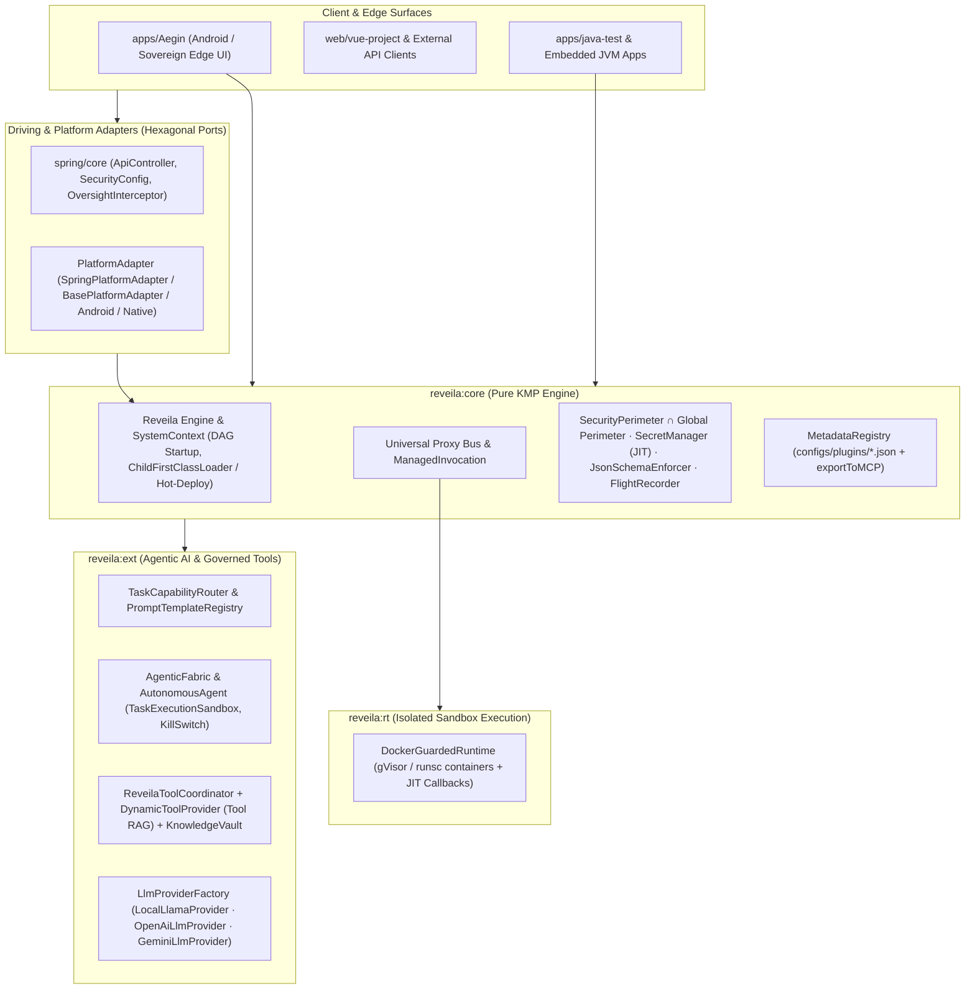

# Reveila-Suite: Platform Overview, Sovereign Agentic Architecture & Competitive Positioning

> **One Multiplatform Core. Pre-Baked Enterprise Plumbing. Governed Autonomous AI.**
> Built on **Kotlin Multiplatform (`reveila:core`, `reveila:ext`)**, **Guarded Sandbox Runtimes (`reveila:rt`)**, and **Non-Disruptive Server & Edge Adapters (`spring:core`, `apps:Aegin`)**, Reveila turns ideas—and existing enterprise software—into secure, multi-platform, AI-native applications in days instead of quarters.

**Companion Guide:** Ready to build? See [Reveila Developer Guide & Tutorials](./Reveila%20Developer%20Guide%20%26%20Tutorials.md).

---

## 1. Executive Introduction: Why Reveila Is a Game Changer for Rapid Application Development

Modern engineering teams face an uncomfortable trade-off when building software—especially AI-enabled software:

* **Build from scratch or wire raw LLM libraries together**, and you spend months rebuilding foundational infrastructure every real system needs: component lifecycle, dependency injection, encrypted secret storage, permission boundaries, audit logs, REST gateways, multi-device sync, offline fallbacks, and container sandboxing.
* **Adopt cloud-only AI SDKs**, and you inherit privacy liabilities, unpredictable API bills, vendor lock-in, and zero offline survivability.
* **Bolt AI agents onto legacy systems**, and teams either risk dangerous prompt-to-action execution or are forced into disruptive, multi-quarter rewrites.

**Reveila-Suite eliminates that trade-off.** It pairs a **Universal Execution Fabric** with a **Sovereign Agentic AI Engine** so teams launch from Day 1 on an already-wired, production-hardened runtime:

| Traditional AI / App Stack | With Reveila-Suite |
| :--- | :--- |
| Stitch together 8–12 libraries (DI, config, DB repos, secrets vault, REST API, RAG vector store, tool sandboxes, LLM wrappers). | **Pre-baked core platform** (`reveila:core` + `reveila:ext`) wired declaratively from `system-home` configs. |
| Separate server backend, mobile logic, and desktop agent codebases. | **Write core logic once in Kotlin Multiplatform (`commonMain`)** targeting JVM/Spring Boot, Android, Apple (iOS/macOS), Windows (`mingwX64`), and Linux (`linuxX64`). |
| Unbounded `@tool` functions executing arbitrary code directly inside host memory. | **Security Perimeters, JIT tokens, Blinded Secrets, Dual-Model Audits, Human-In-The-Loop (HITL) approvals, and gVisor Docker sandboxes.** |
| AI tools locked into a single cloud model or provider. | **Hybrid Edge + Cloud routing (`TaskCapabilityRouter`)**: private on-device `LocalLlamaProvider` (GGUF) for fast offline turns, automatic escalation to Cloud (`OpenAiLlmProvider`, `GeminiLlmProvider`, OpenAI-compatible endpoints) for live retrieval or complex synthesis. |
| Legacy monoliths left untouched or rewritten from scratch. | **Non-disruptive wrapping**: expose existing Java/Spring/service components over a unified Proxy Bus and `/api/components/{componentName}/invoke` without rewriting callers. |

---

## 2. Core Architectures

Reveila is organized around four reinforcing architectural pillars built for **speed-to-market** without compromising **extensibility** or **zero-trust control**.

### 2.1 Pre-Baked Foundation (Zero Plumbing Overhead)

Rather than rebuilding enterprise infrastructure on every project, Reveila ships a ready-to-run component fabric:

* **Declarative Component Topology:** Services and domain components are declared in `configs/shared/standard.json` and platform overlays (`configs/java/java.json`, `configs/spring/spring.json`, `configs/android/android.json`). The `Reveila` engine resolves dependencies, validates manifests with `ConfigurationLinter`, and manages ordered `start()` / `shutdown()` lifecycles via `SystemProxy`.
* **Built-In Operational Services:** `DataService` (pluggable repository persistence), `UsageTracker` (LLM token & cost logging), `FlightRecorder` (forensic reasoning and action trails), `InboundWebhookService`, and `AgentSessionManager` (persistent multi-space session history) work out of the box.
* **Standalone or Clustered Universal OS Mode:** Controlled through `reveila.properties` (`system.standalone=true/false`), the identical application core runs embedded on a single edge device or across a peer-routed Spring Boot cluster.

### 2.2 Flexibility via Hexagonal Multiplatform & Hot-Deploy Plugins

* **Single Codebase Across Server & Edge:** Core business, AI orchestration, RAG (`KnowledgeVault`), and governed tools live in `commonMain` Kotlin Multiplatform, compiling cleanly to **JVM 17**, **Android**, **iOS/macOS (`XCFramework`)**, **Windows (`mingwX64`)**, and **Linux (`linuxX64`)** (see [reveila/core/build.gradle.kts](../../reveila/core/build.gradle.kts)).
* **Clean Hexagonal Ports (`PlatformAdapter`):** Filesystem, concurrency locks, scheduling, HTTP engines, and native cryptography sit behind uniform ports (`PlatformFileSystem`, `PlatformHttpEngine`, `Cryptographer`, `PlatformLock`).
* **Plugin ≠ AI Tool Governance:** Deployable runtime plugins (`configs/plugins/*.json`) and AI-callable tools are intentionally separated. Standard service plugins (such as [EchoService.json](../../system-home/standard/configs/plugins/EchoService.json)) run privately without bloating LLM context; setting `"expose_as_tool": true` or `"tool_definitions"` in JSON turns any plugin into a discoverable, governed AI tool via [MetadataRegistry.kt](../../reveila/core/src/commonMain/kotlin/com/reveila/safety/MetadataRegistry.kt) without changing core engine code.
* **Isolated Hot-Deploy Plugins:** JVM plugins load inside `ChildFirstURLClassLoader`, isolating plugin dependencies from the host application.

### 2.3 Security & Control (Defense in Depth)

Reveila treats LLM output and third-party plugins as **untrusted intent until validated**:

1. **Prompt & Response Guardrails (`GovernancePolicy` & `AiIntentValidator`):** Governed by [governance-policy.json](../../system-home/standard/configs/governance-policy.json), prompts are scored for injection patterns and prohibited shell/SQL commands, while responses pass through DLP redaction (SSN, private keys, cloud API keys, JWTs).
2. **Dual-Model Governance Audit:** When `dualModelGovernance` is active, a separate governance model audits tool invocations proposed by the worker LLM before execution.
3. **Least-Privilege Perimeter Intersection:** Global bounds (`global-perimeter.json`) are intersected (`SecurityPerimeter.intersect(...)`) with plugin-specific `agency_perimeter` limits so the **most restrictive** memory, CPU, timeout, network access, domain whitelist, and delegation policy always wins.
4. **Zero-Knowledge Credentials (`SecretManager` & `PasswordManager`):** Secrets and logins stay outside LLM prompts. Tools support blinded `SEC:<key>` environment injection (`TerminalTool`) and domain-scoped `autofillLogin` (`VirtualBrowserTool`), alongside short-lived **JIT tokens** for sandbox callbacks.
5. **Human-In-The-Loop (HITL) & Interactive Takeover (`ToolActivityHub`):** Non-read-only tool actions and missing credentials pause cleanly with `AI_STATUS_ESCALATE` (`APPROVAL_REQUIRED`), allowing the user to review/edit commands or grant scoped permissions (`Approve Once` / `Always Allow`). During browser automation, CAPTCHAs or 2FA trigger seamless user takeover (`request_takeover`) and return-control handoff.
6. **Container Isolation (`reveila:rt`):** [DockerGuardedRuntime.java](../../reveila/rt/src/main/java/com/reveila/rt/DockerGuardedRuntime.java) executes isolated plugins inside gVisor (`runsc`) containers bounded by `SecurityPerimeter` and wired back through signed, version-checked JIT callbacks.

### 2.4 Speed-to-Market

* **Pure-Config Agent Workflows & Tool Controls:** Add scheduled autonomous jobs by dropping JSON into `tasks/*.json` (like [daily-news.json](../../system-home/standard/tasks/daily-news.json)), tune hybrid routing in [capabilities.json](../../system-home/standard/configs/capabilities.json), and toggle plugin tool availability, model size floors (`min_parameter_size_b`), or routing keywords purely in `configs/plugins/*.json`.
* **Built-In Model Tuning (`PromptTemplateRegistry`):** Adapts automatically across local GGUF models (`Qwen 2.5`, `Gemma 2`, `Llama 3`, `Phi-3`, `Mistral`) and Cloud APIs (`OpenAI`, `Gemini`, local OpenAI-compatible servers) using markdown frontmatter templates under `configs/templates/prompts/`. Small local models (`<= 2.2B`) automatically stay on lightweight `CONVERSATIONAL` prompting unless a turn clearly requires tools.

---

## 3. Agentic AI, Legacy Integration & Competitive Comparison

### 3.1 The Sovereign Agentic AI Fabric

Reveila's AI layer (`reveila:ext`) delivers **bounded, observable autonomy**:

* **Hybrid Edge-to-Cloud Routing (`TaskCapabilityRouter`):** Maps tasks across 6 categories (`LOCAL_TEXT_TRANSFORM`, `LOCAL_STRUCTURED_EXTRACT`, `LOCAL_DEVICE_ACTION`, `CLOUD_LIVE_RETRIEVAL`, `CLOUD_DEEP_REASONING`, `CLOUD_MULTI_STEP_AGENT`) so sensitive summarization runs offline in milliseconds while live web retrieval escalates seamlessly to Cloud in `Auto` mode.
* **Bounded Agentic Execution Loop ([AgenticFabric.kt](../../reveila/ext/src/commonMain/kotlin/com/reveila/ai/AgenticFabric.kt)):** Orchestrates iterative reasoning (`COMPLETED`, `TOOL CALL`, `ESCALATE`, `INSUFFICIENT CONTEXT`, `FAILED`) within `aiLoopLimit`, supports both prompt-structured JSON `"tool-call"` envelopes and native OpenAI/Gemini `tool_calls`, suppresses repetition loops (`AiResponseValidator`), and persists session checkpoints across HITL approvals.
* **Minimal General Tools + Two-Stage Tool RAG (`DynamicToolProvider` & [ReveilaToolCoordinator.kt](../../reveila/ext/src/commonMain/kotlin/com/reveila/ai/ReveilaToolCoordinator.kt)):**
  * Ships a compact general-purpose core toolset — **Web Browser** (`virtual_browser` with web search, navigation, form interaction, cookies, and manual takeover), **Command Terminal** (`terminal` with live output streaming and blinded secrets), **File Downloader** (`resumable_download` with SHA-256 verification and pause/resume), plus **Secret Vault / Password Manager**.
  * Scales cleanly to specialized tool ecosystems via vector search + reranking **Tool RAG** (`DynamicToolProvider`) combined with per-model manifest filtering (`cloudOnly`, `minParameterSizeB`, `allowedModels`).
* **Multi-Worker Background Tasks (`AutonomousAgent`):** Scans `${REVEILA_HOME}/tasks` periodically and executes each job in an isolated `TaskExecutionSandbox` with its own session, security perimeter, and preemptive `KillSwitch`.
* **Scoped Private Knowledge (`KnowledgeVault`):** Indexes nested workspace folders locally and constrains RAG retrieval to user-selected directories.

### 3.2 Legacy Integrations Without Disruption

Organizations rarely have the luxury of rewriting core systems to adopt AI. Reveila lets existing Java backends, Spring Boot applications, databases, and internal microservices participate safely without altering existing callers:

1. **Expose Existing Services via the Proxy Bus:** Declare a legacy class or thin adapter in `configs/shared/*.json` or `configs/plugins/*.json`. Existing callers remain untouched; new workflows and agents invoke the service uniformly via `SystemContext.getProxy(name)` or `ManagedInvocation`.
2. **One Unified Endpoint for Every Component ([ApiController.java](../../spring/core/src/main/java/com/reveila/spring/system/ApiController.java)):** `POST /api/components/{componentName}/invoke` accepts a versioned [MethodDTO](../../spring/core/src/main/java/com/reveila/spring/system/MethodDTO.java), enforcing API compatibility, RBAC (`Subject` / `RolePrincipal`), and `OversightInterceptor` governance without writing custom REST controllers per integration.
3. **Zero-Rewrite Opt-In & Safe Argument Binding:** Legacy plugins stay non-AI by default until `"expose_as_tool": true` is configured, and [ManagedInvocation.kt](../../reveila/core/src/commonMain/kotlin/com/reveila/safety/ManagedInvocation.kt) binds named JSON arguments from LLMs into declared JVM parameter order automatically.
4. **Hard Isolation for Untrusted Binaries:** High-risk legacy wrappers can run inside `DockerGuardedRuntime` (`gVisor`) and communicate back with the host exclusively through expiring JIT callback tokens (`ManagedInvocation.handleCallback`).

### 3.3 Direct Comparison: Reveila vs. LangChain vs. AutoGen

| Dimension | **Reveila-Suite** | **LangChain / LangGraph** | **Microsoft AutoGen** |
| :--- | :--- | :--- | :--- |
| **Architectural Scope** | Full **KMP Application Runtime + Sovereign Agentic Fabric + Security Control Plane**. | Python / TypeScript **LLM chaining and graph orchestration library**. | Python / .NET **multi-agent conversation framework**. |
| **Platform Reach** | **Server (Spring Boot / JVM), Android, iOS, macOS, Windows, Linux** from one `commonMain` core. | Server-centric Python / Node (mobile apps require separate backends and client stacks). | Server-centric Python / .NET (no unified mobile/native edge runtime). |
| **Security, Secrets & Governance** | Built-in `SecurityPerimeter` intersection, RBAC `Subject`, `SecretManager` JIT tokens, blinded `SEC:` env injection, DLP redaction, Dual-Model Governance Audit, HITL approval gates. | Middleware/callbacks are developer-assembled; tools typically execute in host process context unless wrapped separately. | Supports Docker code executors for agents, while RBAC, credential blinding, DLP, and perimeter intersection are left to the app team. |
| **Container Sandboxing** | Native **`DockerGuardedRuntime` (gVisor `runsc`)** driven directly from `SecurityPerimeter` manifests + JIT host callbacks. | External/DIY integrations. | Built-in Docker code-execution containers without unified host-bus JIT callback tokens. |
| **Plugin vs. Tool Governance** | **Config-driven Plugin ≠ Tool**: deploy plugins independently, opt in per tool via JSON (`expose_as_tool`, `cloud_only`, `min_parameter_size_b`), plus two-stage **Tool RAG**. | Code-first `@tool` bindings; selective tool filtering is assembled manually per graph. | Functions registered per conversable agent in Python code; no manifest-level model/size gating. |
| **Offline & Edge Sovereignty** | Native `LocalLlamaProvider` (GGUF), `TaskCapabilityRouter` (offline vs. cloud), local `KnowledgeVault`, and small-model prompt safety (`<= 2.2B` guardrails). | Requires external Ollama/llama.cpp wiring plus custom routing logic. | Assumes external inference APIs; no built-in small-edge prompt degradation guards. |
| **Legacy Enterprise Integration** | Unified Proxy Bus + `POST /api/components/{name}/invoke` + `ChildFirstURLClassLoader` plugin isolation + Spring Boot Admin support. | Requires custom FastAPI/HTTP wrapper services around legacy systems. | Requires custom Python wrappers around existing enterprise systems. |
| **Human-In-The-Loop** | Built-in authorization modals (`APPROVAL_REQUIRED`), editable terminal script review, & live browser takeover (`CAPTCHA` / `2FA` handoff). | `interrupt()` checkpoints in LangGraph (UI & takeover mechanics built separately). | Console/chat `HUMAN_INPUT_MODE` hooks (live WebView takeover & vault built separately). |

**Summary Verdict:**
Choose **LangChain/LangGraph** or **AutoGen** when prototyping Python-based LLM workflows inside a notebook or standalone AI microservice. Choose **Reveila-Suite** when delivering **complete multi-platform software or governed enterprise AI applications** that demand pre-baked infrastructure, non-disruptive legacy integration, offline edge sovereignty, and enforceable security boundaries from Day 1.
