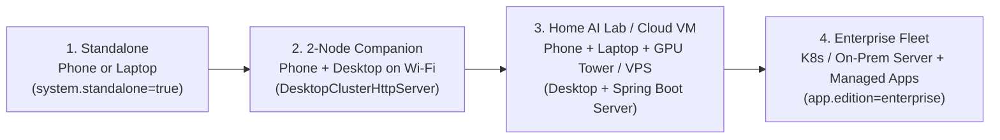

# Unified Cluster Deployment Architecture (Consumer & Enterprise)

This document defines Reveila / Aegin's unified deployment model, consolidating the **Mobile–Desktop Companion** setup, **Home AI Lab Wi-Fi Clusters**, **Personal Cloud VM / VPS nodes**, and **Enterprise Multi-Node Server Fleets** into one single cluster runtime architecture.

---

## 1. Core Principle: Two Orthogonal Axes

Never couple **Edition (Governance Policy)** to **Runtime Footprint (Desktop vs. Server)**:

| Axis | Property (`reveila.properties`) | Values | What It Governs |
|---|---|---|---|
| **Edition (Policy)** | `app.edition` | `individual` \| `enterprise` | Custom webhooks (`CUSTOM_WEBHOOK`), editable `governance-policy.json`, white-label `app_theme.json` lock, RBAC & audit retention |
| **Runtime Footprint** | `node.runtime` | `mobile` \| `desktop` \| `server` | Packaging & host transport: Mobile KMP app, Desktop KMP app with embedded HTTP server, or Headless Spring Boot / Docker server |

Because these axes are independent:
- An **individual power user** can run a headless Cloud VM (`app.edition=individual`, `node.runtime=server`).
- An **enterprise employee** can run a locked-down Desktop + Mobile cluster (`app.edition=enterprise`, `node.runtime=desktop` / `mobile`).

---

## 2. Unified Node Roles & Compute Power

Every Aegin / Reveila installation is a **Cluster Node** speaking the same Cluster Join protocol (Endpoint URL(s) + `cluster.secret` + Capability Profile):

| Role (`cluster.role`) | Typical Device | Leader Election | Behavior |
|---|---|---|---|
| `EDGE_CLIENT` | Mobile phone, tablet, thin laptop | `cluster.can.elect.leader=false` | Runs locally in stand-by when offline; automatically joins its paired Leader (LAN or WAN) when reachable. |
| `WORKER` | Secondary Desktop, GPU tower, Mac Mini | Optional (`AUTO`) | Contributes GPU VRAM / RAM compute (`HIGH` / `SUPER`) to execute heavy GGUF, RAG, or `AutonomousAgent` workloads. |
| `LEADER` | Primary Desktop, always-on Mini PC, or Cloud VM | Primary coordinator | Hosts cluster registry, task orchestration, and routes workloads to the highest-compute available node. |
| `AUTO` | Desktop / Server default | Compute-weighted | Elects Leader automatically using `cluster.node.compute.power=AUTO` (derived from RAM + detected GPU/VRAM). |

---

## 3. Desktop Mode vs. Headless Server Mode

Desktop and Server modes share the **exact same `reveila/core` + `reveila/ext` engine and cluster protocol**, differing only at the host wrapper layer:

### A. Desktop Mode (`node.runtime=desktop` — Aegin Desktop)
- **Host:** KMP Compose Desktop app + lightweight embedded `DesktopClusterHttpServer` (no Spring Boot overhead).
- **Discovery:** Automatic LAN UDP broadcast discovery (`AndroidLanDiscoveryClient`) + optional Tailscale / WireGuard remote URL.
- **Target use:** Zero-ops double-click setup for 1–5 devices on home Wi-Fi or personal VPN.

### B. Headless Server Mode (`node.runtime=server` — `spring/` module / Docker)
- **Host:** Spring Boot web server + REST/Cluster API + optional Web UI.
- **Hardening:** Designed for **Internet-facing & 24/7 headless** nodes (TLS/HTTPS termination, reverse proxy / CORS, rate limiting, OAuth2/OIDC/JWT, multi-tenant isolation, external PostgreSQL/pgvector, `/actuator/health` & metrics).
- **Target use:** Always-on home GPU towers / Mac Minis, rented Cloud VMs / VPSs, and Enterprise on-prem or Kubernetes deployments.

---

## 4. Security & Standalone Boundary

- **`system.standalone=true` remains the safe default** on fresh installs (zero LAN broadcasts, zero UDP discovery, zero open cluster ports — safe for public Wi-Fi and air-gapped environments).
- **Joining / Hosting a Cluster** explicitly flips `system.standalone=false` and authenticates all cluster traffic with a shared `cluster.secret` (stored via `SecretManager`).
- When a paired `EDGE_CLIENT` leaves home Wi-Fi (and has no WAN/Tailscale URL), it gracefully runs in local stand-by and rejoins its authenticated Leader automatically once reachable again.

---

## 5. Deployment Progression (Same App, Same Protocol)



---

## 6. Configuration Reference (`reveila.properties`)

```properties
# Deployment policy edition: individual | enterprise
app.edition=individual

# Host runtime footprint: mobile | desktop | server
node.runtime=desktop

# Default standalone boundary (flipped to false automatically upon cluster pairing)
system.standalone=true

# Cluster leadership & compute tier
cluster.leader.url=http://127.0.0.1:8080
cluster.node.compute.power=AUTO
```
