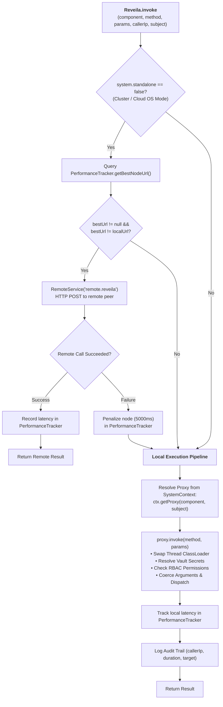
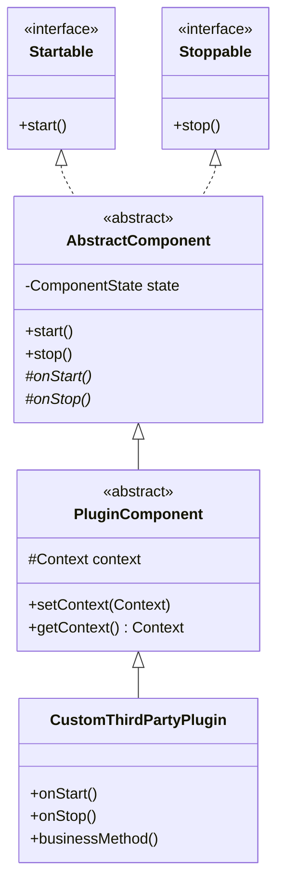

# [ADR-0001]: Architecture Principles

* **Status:** Accepted
* **Deciders:** Charles Lee
* **Date:** 2026-01-17 (Updated: 2026-11-11)
* **Tags:** #architecture #kmp #hexagonal #proxy #invocation #plugins #security #agentic-fabric #three-tier

---

## 1. Executive Summary & Vision

Reveila is an extensible, universal application framework and runtime platform engineered to execute consistently across enterprise cloud backends, edge servers, and sovereign mobile/desktop operating systems. The platform enforces strict process isolation, managed proxy invocations, hexagonal decoupling, role-based access control (RBAC), a native Agentic AI execution fabric, and an elastic clustering architecture that allows Reveila to function as a **Universal Cloud Operating System**.

The platform is architected as a **Three-Tier Modular Platform & Capability Suite** — an active, layered runtime from which apps selectively assemble live capabilities:
1. **`reveila:core` (Microkernel)**: A pure [Kotlin Multiplatform (KMP)](file:///c:/IDE/Projects/Reveila-Suite/reveila/core) runtime providing proxy dispatch, lifecycle orchestration, platform abstraction ports, security perimeters, and core contracts with zero external dependencies.
2. **`reveila:ext` (Extended Capabilities & AI Fabric)**: A multiplatform capability suite hosting autonomous agents, first-class AI tool models ([`ToolCall`](file:///c:/IDE/Projects/Reveila-Suite/reveila/ext/src/commonMain/kotlin/com/reveila/ai/ToolCall.kt)), RAG knowledge vaults, LLM provider integrations, browser tools ([`VirtualBrowser`](file:///c:/IDE/Projects/Reveila-Suite/reveila/ext/src/commonMain/kotlin/com/reveila/tools/browser/VirtualBrowser.kt)), tool dispatching, and workflow engines.
3. **`reveila:rt` (Guarded Container Runtime)**: A server-side containerized sandbox leveraging Docker and gVisor micro-VMs to execute untrusted third-party code with hard kernel-level isolation.

Whether deployed as a sovereign standalone node (`system.standalone=true`) on an air-gapped device or scaling across an elastic multi-node cloud cluster governed by a Central Registry (`system.standalone=false`), Reveila maintains a unified programming model, strict encapsulation, and deterministic execution semantics.

---

## 2. System Architecture & Topology

### 2.1 The Three-Tier Modular Platform Architecture

Reveila structures its **active, layered runtime** into three distinct tiers—separating foundational microkernel mechanics from high-level AI capabilities and heavy server containerization—so apps can selectively assemble only the live capabilities they require:

```
┌─────────────────────────────────────────────────────────────────────────────────────────────────┐
│                                          reveila:core                                           │
│                 The Microkernel • Pure KMP (Common, JVM, Android, iOS, Desktop)                 │
│  • Component Lifecycle & IoC (Reveila, Context, Proxy, PlatformAdapter)                         │
│  • Security & Governance Core (Subject, RolePrincipal, SecurityPerimeter, ManagedInvocation)    │
│  • Core & Audit Contracts (InvocationRequest [generic invocation contract], FlightRecorder)     │
│  • Data, Vector & Cryptography (VectorStore, Entity, Repositories, PlatformCryptographer)       │
│  • Platform Low-Level Ports & I/O (PlatformSystem, PlatformFileSystem, PlatformLock, Terminal)  │
│  • Universal Event Bus & Cross-Platform Utilities (EventManager, JSON, IO, XML, Markdown)       │
└────────────────────────────────────────────────┬────────────────────────────────────────────────┘
                                                 │ (Inherits Contracts & Abstractions)
                       ┌─────────────────────────┴─────────────────────────┐
                       ▼                                                   ▼
┌─────────────────────────────────────────────┐     ┌─────────────────────────────────────────────┐
│                 reveila:ext                 │     │                 reveila:rt                  │
│      Extended Capabilities & AI Fabric      │     │           Guarded Server Runtime            │
│           (Kotlin Multiplatform)            │     │            (JVM / Linux Server)             │
│ • Agentic AI Fabric (AgenticFabric)         │     │ • Docker Client & gVisor (runsc) Sandboxes  │
│ • First-Class ToolCall (AI Tool Model)      │     │ • Linux cgroups & Micro-VM Isolation        │
│ • Autonomous Agents & Session Memory        │     │ • Remote Container Callback Pipeline        │
│ • Knowledge Vault & Semantic Embeddings     │     │ • Cloud S3 Vault Synchronization            │
│ • LLM Providers (Llama, Gemini, OpenAI)     │     │                                             │
│ • Dynamic Tool Providers & Dispatchers      │     │                                             │
│ • Browser Tools (VirtualBrowser, etc.)      │     │                                             │
└─────────────────────────────────────────────┘     └─────────────────────────────────────────────┘
```

| Tier Project | Role & Purpose | Target Platforms | Key Capabilities & Packages |
| :--- | :--- | :--- | :--- |
| **[`reveila:core`](file:///c:/IDE/Projects/Reveila-Suite/reveila/core)** | **Microkernel** | Kotlin Multiplatform (`commonMain`, `jvmMain`, `androidMain`, `appleMain`, `mingwMain`, `linuxMain`) | Component lifecycle ([`Startable`](file:///c:/IDE/Projects/Reveila-Suite/reveila/core/src/commonMain/kotlin/com/reveila/system/Startable.kt), [`Stoppable`](file:///c:/IDE/Projects/Reveila-Suite/reveila/core/src/commonMain/kotlin/com/reveila/system/Stoppable.kt)), contexts ([`Context`](file:///c:/IDE/Projects/Reveila-Suite/reveila/core/src/commonMain/kotlin/com/reveila/system/Context.kt), [`PluginContext`](file:///c:/IDE/Projects/Reveila-Suite/reveila/core/src/commonMain/kotlin/com/reveila/system/PluginContext.kt)), proxies ([`Proxy`](file:///c:/IDE/Projects/Reveila-Suite/reveila/core/src/commonMain/kotlin/com/reveila/system/Proxy.kt), [`SystemProxy`](file:///c:/IDE/Projects/Reveila-Suite/reveila/core/src/jvmMain/kotlin/com/reveila/system/SystemProxy.kt)), hexagonal port ([`PlatformAdapter`](file:///c:/IDE/Projects/Reveila-Suite/reveila/core/src/commonMain/kotlin/com/reveila/system/PlatformAdapter.kt)), RBAC ([`Principal`](file:///c:/IDE/Projects/Reveila-Suite/reveila/core/src/commonMain/kotlin/com/reveila/system/Principal.kt), [`Subject`](file:///c:/IDE/Projects/Reveila-Suite/reveila/core/src/commonMain/kotlin/com/reveila/system/Subject.kt)), safety & audit ([`InvocationRequest`](file:///c:/IDE/Projects/Reveila-Suite/reveila/core/src/commonMain/kotlin/com/reveila/safety/InvocationRequest.kt), [`ManagedInvocation`](file:///c:/IDE/Projects/Reveila-Suite/reveila/core/src/commonMain/kotlin/com/reveila/safety/ManagedInvocation.kt), [`FlightRecorder`](file:///c:/IDE/Projects/Reveila-Suite/reveila/core/src/commonMain/kotlin/com/reveila/safety/FlightRecorder.kt)), persistence ([`VectorStore`](file:///c:/IDE/Projects/Reveila-Suite/reveila/core/src/commonMain/kotlin/com/reveila/persistence/VectorStore.kt)), platform ports ([`PlatformLock`](file:///c:/IDE/Projects/Reveila-Suite/reveila/core/src/commonMain/kotlin/com/reveila/system/concurrency/PlatformLock.kt), [`Terminal`](file:///c:/IDE/Projects/Reveila-Suite/reveila/core/src/commonMain/kotlin/com/reveila/tools/Terminal.kt)), cryptography, manifest parser. |
| **[`reveila:ext`](file:///c:/IDE/Projects/Reveila-Suite/reveila/ext)** | **Extended Capabilities & AI Fabric** | Kotlin Multiplatform (`commonMain`, `jvmMain`, `androidMain`, `appleMain`, `mingwMain`, `linuxMain`) | Agentic AI Fabric ([`AgenticFabric`](file:///c:/IDE/Projects/Reveila-Suite/reveila/ext/src/commonMain/kotlin/com/reveila/ai/AgenticFabric.kt)), first-class [`ToolCall`](file:///c:/IDE/Projects/Reveila-Suite/reveila/ext/src/commonMain/kotlin/com/reveila/ai/ToolCall.kt), autonomous agents ([`AutonomousAgent`](file:///c:/IDE/Projects/Reveila-Suite/reveila/ext/src/commonMain/kotlin/com/reveila/ai/AutonomousAgent.kt)) & session memory ([`AgentSession`](file:///c:/IDE/Projects/Reveila-Suite/reveila/ext/src/commonMain/kotlin/com/reveila/ai/AgentSession.kt)), Knowledge Vault ([`KnowledgeVault`](file:///c:/IDE/Projects/Reveila-Suite/reveila/ext/src/commonMain/kotlin/com/reveila/ai/KnowledgeVault.kt)), LLM providers, Tool RAG, browser tools ([`VirtualBrowser`](file:///c:/IDE/Projects/Reveila-Suite/reveila/ext/src/commonMain/kotlin/com/reveila/tools/browser/VirtualBrowser.kt)), telemetry. |
| **[`reveila:rt`](file:///c:/IDE/Projects/Reveila-Suite/reveila/rt)** | **Guarded Runtime** | JVM (Server Deployments) | Docker daemon control ([`DockerGuardedRuntime`](file:///c:/IDE/Projects/Reveila-Suite/reveila/rt/src/main/java/com/reveila/rt/DockerGuardedRuntime.java)), gVisor runtime flags, memory/CPU cgroup enforcement, container network isolation, callback routing. |

---

### 2.2 The Core Microkernel (`reveila:core` - Pure KMP)

The Core Engine is a self-contained runtime compiling to platform-specific bytecode and native binaries:
* **[`commonMain`](file:///c:/IDE/Projects/Reveila-Suite/reveila/core/src/commonMain)**: Pure multiplatform contracts, lifecycle definitions ([`Startable`](file:///c:/IDE/Projects/Reveila-Suite/reveila/core/src/commonMain/kotlin/com/reveila/system/Startable.kt), [`Stoppable`](file:///c:/IDE/Projects/Reveila-Suite/reveila/core/src/commonMain/kotlin/com/reveila/system/Stoppable.kt)), component bases ([`AbstractComponent`](file:///c:/IDE/Projects/Reveila-Suite/reveila/core/src/commonMain/kotlin/com/reveila/system/AbstractComponent.kt), [`PluginComponent`](file:///c:/IDE/Projects/Reveila-Suite/reveila/core/src/commonMain/kotlin/com/reveila/system/PluginComponent.kt), [`SystemComponent`](file:///c:/IDE/Projects/Reveila-Suite/reveila/core/src/commonMain/kotlin/com/reveila/system/SystemComponent.kt)), context abstractions ([`Context`](file:///c:/IDE/Projects/Reveila-Suite/reveila/core/src/commonMain/kotlin/com/reveila/system/Context.kt), [`PluginContext`](file:///c:/IDE/Projects/Reveila-Suite/reveila/core/src/commonMain/kotlin/com/reveila/system/PluginContext.kt), [`SystemContext`](file:///c:/IDE/Projects/Reveila-Suite/reveila/core/src/commonMain/kotlin/com/reveila/system/SystemContext.kt)), proxy contracts ([`Proxy`](file:///c:/IDE/Projects/Reveila-Suite/reveila/core/src/commonMain/kotlin/com/reveila/system/Proxy.kt), [`PluginProxy`](file:///c:/IDE/Projects/Reveila-Suite/reveila/core/src/commonMain/kotlin/com/reveila/system/PluginProxy.kt)), metadata parsers ([`Manifest`](file:///c:/IDE/Projects/Reveila-Suite/reveila/core/src/commonMain/kotlin/com/reveila/system/Manifest.kt), [`MetaObject`](file:///c:/IDE/Projects/Reveila-Suite/reveila/core/src/commonMain/kotlin/com/reveila/system/MetaObject.kt)), safety metadata ([`SecurityPerimeter`](file:///c:/IDE/Projects/Reveila-Suite/reveila/core/src/commonMain/kotlin/com/reveila/safety/SecurityPerimeter.kt), [`MetadataRegistry`](file:///c:/IDE/Projects/Reveila-Suite/reveila/core/src/commonMain/kotlin/com/reveila/safety/MetadataRegistry.kt)), and platform I/O interfaces. Zero JVM or OS dependencies.
* **[`jvmMain`](file:///c:/IDE/Projects/Reveila-Suite/reveila/core/src/jvmMain)**: JVM-specific implementations including reflection method dispatch ([`ReflectionMethod`](file:///c:/IDE/Projects/Reveila-Suite/reveila/core/src/jvmMain/kotlin/com/reveila/system/ReflectionMethod.kt)), Child-First URL classloading ([`ChildFirstURLClassLoader`](file:///c:/IDE/Projects/Reveila-Suite/reveila/core/src/jvmMain/kotlin/com/reveila/system/ChildFirstURLClassLoader.kt)), [`SystemProxy`](file:///c:/IDE/Projects/Reveila-Suite/reveila/core/src/jvmMain/kotlin/com/reveila/system/SystemProxy.kt), and [`Reveila`](file:///c:/IDE/Projects/Reveila-Suite/reveila/core/src/jvmMain/kotlin/com/reveila/system/Reveila.kt) engine orchestration.
* **[`androidMain`](file:///c:/IDE/Projects/Reveila-Suite/reveila/core/src/androidMain)**: Android ART platform actuals, Android lifecycle bindings, and DEX classloader adapters.
* **Native Targets (`mingwMain`, `appleMain`, `linuxMain`)**: Native C/C++ dynamic libraries (e.g. `reveila_core.dll`, `reveila_core_api.h`, Apple XCFrameworks) and POSIX bindings.

---

### 2.3 Decoupled Binary Distribution & Selective Capability Assembly

To preserve modular boundaries, downstream applications do not depend directly on engine source projects. Instead, the workspace relies on pre-built binary distributions exported via the Gradle distribution pipeline (`distribution/`):

* **`distribution/jvm/reveila-core.jar`**: Compiled targeting Java 17 bytecode (class major version 61.0) for universal compatibility across Spring Boot 3.x and Android ART/Dalvik runtimes.
* **`distribution/jvm/reveila-ext.jar`**: Multiplatform capability suite containing the Agentic AI fabric, first-class AI tool models, Knowledge Vault, LLM providers, and autonomous browser tools.
* **`distribution/jvm/reveila-rt.jar`**: Guarded Runtime library ([`DockerGuardedRuntime`](file:///c:/IDE/Projects/Reveila-Suite/reveila/rt/src/main/java/com/reveila/rt/DockerGuardedRuntime.java)) for server sandboxing.
* **`distribution/android/reveila-core.aar`**: Android release archive containing platform actuals.
* **`distribution/windows/reveila_core.dll` & `reveila_core_api.h`**: Native Windows release shared library and C headers.

#### Selective Capability Assembly ([`reveila-app-packager`](file:///c:/IDE/Projects/Reveila-Suite/build-logic/src/main/kotlin/reveila-app-packager.gradle.kts))
When client applications (such as [Aegin](file:///c:/IDE/Projects/Reveila-Suite/apps/Aegin) or sovereign mobile apps) build, they selectively assemble only the live capabilities they require rather than bundling the entire platform suite:

```kotlin
reveilaApp {
    requiredComponents.set(listOf(
        "AgenticFabric",
        "AutonomousAgent",
        "KnowledgeVault",
        "LlmProviderFactory"
    ))
}
```

The [`reveila-app-packager.gradle.kts`](file:///c:/IDE/Projects/Reveila-Suite/build-logic/src/main/kotlin/reveila-app-packager.gradle.kts) plugin inspects [`standard.json`](file:///c:/IDE/Projects/Reveila-Suite/system-home/standard/configs/shared/standard.json), resolves the declared components across `reveila-core.jar` and `reveila-ext.jar`, strips unused classes, and packages an optimized, lightweight binary tailored for resource-constrained edge runtimes.

---

### 2.4 Hexagonal Architecture & Platform Adapter Port

The [`PlatformAdapter`](file:///c:/IDE/Projects/Reveila-Suite/reveila/core/src/commonMain/kotlin/com/reveila/system/PlatformAdapter.kt) interface forms the core **Hexagonal Port (Ports & Adapters pattern)** isolating engine domain logic, proxy mechanics, and security perimeters from the host operating system and runtime framework:

```
┌─────────────────────────────────────────────────────────────────────────────────────────────────┐
│                                   TWO DUAL EXECUTION PARADIGMS                                  │
├────────────────────────────────────────────────┬────────────────────────────────────────────────┤
│       MODE A: Enterprise Java Server           │       MODE B: Embedded / Local-First Native    │
│            (Distributed REST Mode)             │          (Self-Contained Mobile/Desktop)       │
│                                                │                                                │
│  External Clients (Web Browser / REST API)     │  Local Client UI / In-Process Host App Code    │
│                     │                          │                     │                          │
│                     ▼                          │                     ▼                          │
│  Spring Boot ApiController (Driving Adapter)   │  Direct In-Process Client Bridge               │
│   POST /api/components/{name}/invoke           │   reveila.invoke() / ctx.getProxy().invoke()   │
│   • Auth -> Subject(RolePrincipal)             │   • Local Subject(RolePrincipal("ui-client"))  │
│   • Caller IP extraction                       │   • Direct in-memory invocation                │
│                     │                          │                                                │
│                     ▼                          │                                                │
│  Clustering / Universal Cloud OS               │                                                │
│  (system.standalone=false)                     │                                                │
│   • Central Registry / Sovereign Ledger        │                                                │
│   • PerformanceTracker -> Best Node Routing    │                                                │
│   • RemoteService ("remote.reveila")           │                                                │
│   • Reactive Pulse (ClusterSyncService)        │                                                │
└───────────────────────┬────────────────────────┴─────────────────────┬──────────────────────────┘
                        │                                              │
                        ▼                                              ▼
┌─────────────────────────────────────────────────────────────────────────────────────────────────┐
│                                    Universal Invocation Bus                                     │
│                       Reveila.invoke() / SystemContext Registry                                 │
└───────────────────────────────┬──────────────────────────────┬──────────────────────────────────┘
                                │                              │
                                ▼                              ▼
                   ┌────────────────────────┐    ┌────────────────────────┐
                   │      System Proxy      │    │      Plugin Proxy      │
                   │    (SystemContext)     │    │    (PluginContext)     │
                   └────────────┬───────────┘    └────────────┬───────────┘
                                │                             │
                                ▼                             ▼
                   ┌────────────────────────┐    ┌────────────────────────┐
                   │   System Components    │    │  Third-Party Plugins   │
                   │ (Platform Capabilities)│    │  (Isolated Sandbox)    │
                   └────────────┬───────────┘    └────────────┬───────────┘
                                │                             │
                                ▼                             ▼
┌─────────────────────────────────────────────────────────────────────────────────────────────────┐
│                          Platform Adapter Port (Hexagonal Abstraction)                          │
│                               interface PlatformAdapter                                         │
├────────────────────────────────────────────────┬────────────────────────────────────────────────┤
│  Driven Adapter A: BasePlatformAdapter         │  Driven Adapter B: AndroidPlatformAdapter /    │
│  (JVM / Spring Boot thread pools, files)       │  Native Win32/POSIX Adapters (Local files, ART)│
└────────────────────────────────┬───────────────┴────────────────┬───────────────────────────────┘
                                 │                                │
                                 ▼                                ▼
┌─────────────────────────────────────────────────────────────────────────────────────────────────┐
│                                   Core Multiplatform Engine                                     │
│         commonMain (Pure Contracts) │ jvmMain │ androidMain │ mingwMain / appleMain / linuxMain │
└─────────────────────────────────────────────────────────────────────────────────────────────────┘
```

---

### 2.5 Dual Execution Paradigms

Reveila supports two first-class deployment paradigms using the exact same microkernel:

#### 2.5.1 Mode A: Enterprise Java Server (Spring Boot / Distributed REST Mode)
In enterprise server environments, the engine runs embedded within a host Spring Boot application (`spring:core`):
* **Driving / Inbound Adapter ([`ApiController`](file:///c:/IDE/Projects/Reveila-Suite/spring/core/src/main/java/com/reveila/spring/system/ApiController.java))**:
  * External clients interact via exposed REST endpoints:
    * Standard Invocation: `@PostMapping("/api/components/{componentName}/invoke")`
    * Dual-Key Overwatch Invocation: `@PostMapping("/api/v1/overwatch/components/{componentName}/invoke")`
    * Container Callback Endpoint: `@PostMapping("/api/system/callback")` (routes callbacks from sandboxed Docker workers back to [`ManagedInvocation`](file:///c:/IDE/Projects/Reveila-Suite/reveila/core/src/commonMain/kotlin/com/reveila/safety/ManagedInvocation.kt))
  * **Security Translation**: Intercepts incoming requests, inspects Spring Security's `Authentication` context, extracts `GrantedAuthority` tokens, strips the `ROLE_` prefix, and constructs a Reveila [`Subject`](file:///c:/IDE/Projects/Reveila-Suite/reveila/core/src/commonMain/kotlin/com/reveila/system/Subject.kt) containing verified [`RolePrincipal`](file:///c:/IDE/Projects/Reveila-Suite/reveila/core/src/commonMain/kotlin/com/reveila/system/Principal.kt) entries.
  * **Dispatch**: Extracts caller IP (`httpRequest.getRemoteAddr()`) and dispatches into the engine:
    ```java
    reveila.invoke(componentName, request.getMethodName(), args, callerIp, subject);
    ```
* **Driven / Outbound Adapter ([`BasePlatformAdapter`](file:///c:/IDE/Projects/Reveila-Suite/reveila/core/src/jvmMain/kotlin/com/reveila/system/BasePlatformAdapter.kt))**:
  * Satisfies engine infrastructure dependencies via JVM thread pools (`ExecutorService`), filesystem resolution (`SystemHome`), scheduled execution, and server cryptographic providers.

#### 2.5.2 Clustered Mode (`system.standalone=false`): The Universal Cloud OS
A foundational property in [`reveila.properties`](file:///c:/IDE/Projects/Reveila-Suite/system-home/standard/configs/reveila.properties) controls whether Reveila runs isolated or as an elastic distributed mesh:

```properties
# Standalone (Single Node) vs. Clustered (Universal Cloud Operating System)
system.standalone=true    # Default: Single-instance local execution
# system.standalone=false # Clustered: Elastic multi-node mesh governed by Central Registry
```

When `system.standalone=false` is configured in Server Mode, Reveila transforms into an elastic **Universal Cloud Operating System**:

1. **Central Registry & Sovereign Ledger**:
   * Topology is orchestrated by a Central Registry backed by PostgreSQL ledger tables (`plugin_registry`, `global_settings`).
   * **Unbounded Horizontal Elasticity**: Any number of Reveila instances can join or leave the cluster dynamically, self-registering with the registry.
   * **Reactive Config Pulses**: Configuration updates (new plugins, updated security perimeters, parameter updates) broadcast real-time events via PostgreSQL `NOTIFY/LISTEN` on channel `reveila_config_updates`. The background [`ClusterSyncService`](file:///c:/IDE/Projects/Reveila-Suite/spring/core/src/main/java/com/reveila/spring/service/ClusterSyncService.java) captures the pulse and triggers `loadProperties()`, achieving instant, zero-downtime cluster-wide synchronization.
2. **Elastic Role-Based Workload Sharding (`cluster.role`)**:
   * Nodes boot with an assigned role (e.g. `cluster.role=FINANCE_WORKER`, `cluster.role=HEAVY_COMPUTE`, `cluster.role=AI_INFERENCE`).
   * Nodes evaluate plugin registrations against their assigned role, downloading and activating only matching plugins for declarative horizontal sharding.
3. **Adaptive Peer Latency Routing ([`PerformanceTracker`](file:///c:/IDE/Projects/Reveila-Suite/reveila/core/src/commonMain/kotlin/com/reveila/system/PerformanceTracker.kt))**:
   * Nodes continuously track peer execution latencies.
   * On `Reveila.invoke(...)`, the engine queries `PerformanceTracker.getInstance().getBestNodeUrl()`. If a remote node exhibits lower latency than the local node (`bestUrl != localUrl`), the call is dynamically routed to the faster peer.
4. **Cross-Node Invocation Bridge ([`RemoteService`](file:///c:/IDE/Projects/Reveila-Suite/reveila/core/src/commonMain/kotlin/com/reveila/service/RemoteService.kt))**:
   * Dispatches remote calls through [`RemoteService`](file:///c:/IDE/Projects/Reveila-Suite/reveila/core/src/commonMain/kotlin/com/reveila/service/RemoteService.kt) (`Constants.REMOTE_REVEILA` = `"remote.reveila"`).
   * Formats HTTP POST payloads to the peer's `/api/components/{componentName}/invoke` endpoint and records response metrics in [`PerformanceTracker`](file:///c:/IDE/Projects/Reveila-Suite/reveila/core/src/commonMain/kotlin/com/reveila/system/PerformanceTracker.kt).
5. **Self-Healing Fault Tolerance & Automatic Local Fallback**:
   * If a remote peer node times out, throws a network error, or fails, [`PerformanceTracker`](file:///c:/IDE/Projects/Reveila-Suite/reveila/core/src/commonMain/kotlin/com/reveila/system/PerformanceTracker.kt) penalizes the node with a 5000 ms penalty (`DEFAULT_PENALTY_MS = 5000L`).
   * The invocation transparently and immediately **falls back to local execution**, guaranteeing zero dropped requests.

#### 2.5.3 Mode B: Embedded / Local-First Multiplatform Mode (Mobile & Desktop Apps)
In client applications, Reveila compiles into native binaries (`reveila-core.aar`, `reveila_core.dll`, Apple frameworks, Linux `.so`) bundled directly into edge applications:
* **Host Application Lifecycle**:
  * The host app does not expose a web server. It directly instantiates and starts the engine:
    ```kotlin
    val reveila = Reveila()
    reveila.start(AndroidPlatformAdapter(context))
    ```
  * During boot, [`Reveila`](file:///c:/IDE/Projects/Reveila-Suite/reveila/core/src/jvmMain/kotlin/com/reveila/system/Reveila.kt) loads manifests locally from `${system.home}/configs/shared` and `${system.home}/configs/${platform}`, validates them via [`ConfigurationLinter`](file:///c:/IDE/Projects/Reveila-Suite/reveila/core/src/commonMain/kotlin/com/reveila/system/ConfigurationLinter.kt), sequences dependencies, and activates auto-start components.
* **Direct In-Process Invocation**:
  * Local UI layers, React Native bridges ([`ReveilaModule.java`](file:///c:/IDE/Projects/Reveila-Suite/android/src/main/java/com/reveila/android/ReveilaModule.java)), or background workers call the engine directly in-process:
    ```kotlin
    reveila.invoke(componentName, methodName, params, "127.0.0.1", subject)
    ```
* **Local-First Value**: Eliminates external network dependencies, cloud latency, and serialization overhead, providing 100% offline, sovereign computation.

#### 2.5.4 Comparative Execution Matrix

| Dimension | Mode A: Enterprise Java Server (Spring Boot) | Mode B: Embedded / Local-First Multiplatform |
| :--- | :--- | :--- |
| **Packaging Target** | `distribution/jvm/reveila-core.jar` + `reveila-ext.jar` | Android `.aar`, Windows `.dll`, Apple framework, Linux `.so` |
| **Host Application** | Spring Boot 3.x web application server | Native Android app ([`ReveilaService`](file:///c:/IDE/Projects/Reveila-Suite/android/src/main/java/com/reveila/android/ReveilaService.java)), Windows desktop app |
| **Inbound / Driving Layer** | REST Controller ([`ApiController`](file:///c:/IDE/Projects/Reveila-Suite/spring/core/src/main/java/com/reveila/spring/system/ApiController.java)) | In-process native bridge ([`ReveilaModule`](file:///c:/IDE/Projects/Reveila-Suite/android/src/main/java/com/reveila/android/ReveilaModule.java)), local UI |
| **Primary Entry Point** | `POST /api/components/{componentName}/invoke` | In-memory `reveila.invoke(...)` / `ctx.getProxy(...)` |
| **Clustering & Scale** | **Universal Cloud OS** (`system.standalone=false`) with Central Registry, or Standalone (`system.standalone=true`) | Dedicated Standalone (`system.standalone=true`) running local-first on device |
| **Identity & Roles** | Spring Security token parsed to [`RolePrincipal`](file:///c:/IDE/Projects/Reveila-Suite/reveila/core/src/commonMain/kotlin/com/reveila/system/Principal.kt) | Local client subject (e.g. `RolePrincipal("ui-client")`) |
| **Driven Adapter** | [`BasePlatformAdapter`](file:///c:/IDE/Projects/Reveila-Suite/reveila/core/src/jvmMain/kotlin/com/reveila/system/BasePlatformAdapter.kt) | [`AndroidPlatformAdapter`](file:///c:/IDE/Projects/Reveila-Suite/android/src/main/java/com/reveila/android/AndroidPlatformAdapter.java), Win32/POSIX native adapters |
| **Transport Latency** | HTTP / JSON serialization network latency | Zero-overhead, sub-millisecond in-process function calls |
| **Target Use Cases** | Multi-tenant cloud backend, elastic clustering, central DB | Sovereign mobile app, edge AI runtime, air-gapped desktop |

---

### 2.6 Tiered Configuration & Component Discovery

Components are declared using JSON manifests rather than hardcoded framework bindings. Reveila employs a two-tier configuration resolution strategy during startup:
1. **Shared Tier**: `${system.home}/configs/shared/*.json` loaded first to supply universal components.
2. **Platform Tier**: `${system.home}/configs/${platform}/*.json` (e.g. `spring/`, `android/`) loaded second, overriding shared declarations with platform-tailored implementations.
3. **Validation & Linting**: All discovered metadata objects ([`MetaObject`](file:///c:/IDE/Projects/Reveila-Suite/reveila/core/src/commonMain/kotlin/com/reveila/system/MetaObject.kt)) are validated by [`ConfigurationLinter`](file:///c:/IDE/Projects/Reveila-Suite/reveila/core/src/commonMain/kotlin/com/reveila/system/ConfigurationLinter.kt) to detect circular dependencies, invalid class references, and configuration conflicts before instantiation.

### 2.7 Dynamic Plugins vs. System Components

* **System Components**: Declared in `configs/shared/` or `configs/${platform}/`. Trusted first-party services running on the host classpath with elevated privileges and direct access to [`PlatformAdapter`](file:///c:/IDE/Projects/Reveila-Suite/reveila/core/src/commonMain/kotlin/com/reveila/system/PlatformAdapter.kt).
* **Dynamic Plugins**: Declared in `configs/plugins/` and stored in `${system.home}/plugins/`. Third-party or untrusted extensions executing under the Principle of Least Privilege, isolated via custom classloaders or container sandboxes, and restricted to a scoped [`PluginContext`](file:///c:/IDE/Projects/Reveila-Suite/reveila/core/src/commonMain/kotlin/com/reveila/system/PluginContext.kt).

---

## 3. Managed Invocation & Runtime Isolation

The Reveila-Suite operates as a strictly proxied system. Direct instantiation and unmediated cross-service calls are strictly prohibited.

### 3.1 The Universal Service Bus (`Reveila.invoke`)

[`Reveila.invoke`](file:///c:/IDE/Projects/Reveila-Suite/reveila/core/src/jvmMain/kotlin/com/reveila/system/Reveila.kt) serves as the Universal Service Bus and central orchestration entry point across both deployment paradigms:



* **Audit Trail**: Logs caller IP, execution duration, target service name, method signature, and authorization status.
* **Resilience**: In clustered mode, any peer network timeout or HTTP exception automatically incurs a penalty and seamlessly executes locally.

---

### 3.2 The Proxy Dispatch Pipeline (`Proxy.invoke`)

[`Proxy.invoke`](file:///c:/IDE/Projects/Reveila-Suite/reveila/core/src/commonMain/kotlin/com/reveila/system/Proxy.kt) is the foundational communication pipeline across all components and plugins:
1. **Classloader Isolation**: Before reflection invocation, the proxy switches the current thread's context classloader (`Thread.currentThread().contextClassLoader`) to the plugin's isolated classloader and restores the host classloader in a `finally` block.
2. **Reflection Dispatch & Argument Coercion**: Handled by [`ReflectionMethod`](file:///c:/IDE/Projects/Reveila-Suite/reveila/core/src/jvmMain/kotlin/com/reveila/system/ReflectionMethod.kt), automatically resolving overloaded methods, coercing numeric primitives, converting collections/arrays, and packaging varargs.
3. **Secret Resolution**: Arguments referencing vault keys (e.g. `${secret:DB_PASSWORD}` or `REF:SECRET_...`) are intercepted and resolved securely via the platform `SecretManager`.
4. **RBAC Enforcement**: Validates caller [`Subject`](file:///c:/IDE/Projects/Reveila-Suite/reveila/core/src/commonMain/kotlin/com/reveila/system/Subject.kt) roles against the target component and method `requiredRoles`.

---

### 3.3 Context Separation & Trust Boundaries

The platform enforces strict context separation based on service trust tier:

| Architectural Dimension | [`SystemContext`](file:///c:/IDE/Projects/Reveila-Suite/reveila/core/src/commonMain/kotlin/com/reveila/system/SystemContext.kt) (Trusted Components) | [`PluginContext`](file:///c:/IDE/Projects/Reveila-Suite/reveila/core/src/commonMain/kotlin/com/reveila/system/PluginContext.kt) (Third-Party Plugins) |
| :--- | :--- | :--- |
| **Trust Tier** | First-party system services | Untrusted or semi-trusted extensions |
| **Assigned Role** | `Constants.SYSTEM` ("system") | `RolePrincipal("plugin")` |
| **Platform Adapter** | Full access to [`PlatformAdapter`](file:///c:/IDE/Projects/Reveila-Suite/reveila/core/src/commonMain/kotlin/com/reveila/system/PlatformAdapter.kt) | Blocked (`null` returned unless role elevated to `system`) |
| **Configuration Scope** | Unrestricted read access to all system properties | Scoped strictly to `plugin.<PluginName>.<key>` and safe globals |
| **Proxy Resolution** | Can resolve any registered component proxy | Wrapped in [`PluginProxy`](file:///c:/IDE/Projects/Reveila-Suite/reveila/core/src/commonMain/kotlin/com/reveila/system/PluginProxy.kt); blocked from system-only components |
| **Runtime Environment** | Host process classpath | Isolated ClassLoader, DEX container, or Docker sandbox |

---

### 3.4 Native Agentic AI Runtime Fabric

Hosted in [`reveila:ext`](file:///c:/IDE/Projects/Reveila-Suite/reveila/ext), the Agentic AI Runtime Fabric implements the Agentic Control Plane, providing a secure gateway for LLMs and autonomous agents interacting with Reveila services:
* **Safety Audits & Guardrails**: Defends against prompt injections, unauthorized intent spoofing, and jailbreak attempts before requests reach the proxy pipeline.
* **Intent Validation against [`MetadataRegistry`](file:///c:/IDE/Projects/Reveila-Suite/reveila/core/src/commonMain/kotlin/com/reveila/safety/MetadataRegistry.kt)**: Ensures model intents map to registered, authorized tools and methods.
* **Agency Perimeter Enforcement ([`SecurityPerimeter`](file:///c:/IDE/Projects/Reveila-Suite/reveila/core/src/commonMain/kotlin/com/reveila/safety/SecurityPerimeter.kt))**: Enforces metadata boundaries restricting network egress (`allowedDomains`), blocking raw Internet access, and imposing CPU/memory quotas.
* **Secret Masking**: Identifies parameters flagged with `isSecret: true` in the plugin manifest, masking credentials, PII, and PHI from AI context windows and flight recorder logs.

---

## 4. Extensibility Architecture: Third-Party Plugin Specification

This section details the architecture, contracts, manifest specifications, and runtime requirements for building, packaging, and deploying plugins for Reveila-Suite.

### 4.1 The Plugin Component Model & Lifecycle

All third-party plugins must inherit from [`PluginComponent`](file:///c:/IDE/Projects/Reveila-Suite/reveila/core/src/commonMain/kotlin/com/reveila/system/PluginComponent.kt) (or [`AbstractComponent`](file:///c:/IDE/Projects/Reveila-Suite/reveila/core/src/commonMain/kotlin/com/reveila/system/AbstractComponent.kt)):



#### Plugin Lifecycle States:
1. **Class Loading**: Bytecode is loaded via an isolated classloader ([`ChildFirstURLClassLoader`](file:///c:/IDE/Projects/Reveila-Suite/reveila/core/src/jvmMain/kotlin/com/reveila/system/ChildFirstURLClassLoader.kt) or [`ChildFirstDexClassLoader`](file:///c:/IDE/Projects/Reveila-Suite/android/src/main/java/com/reveila/android/ChildFirstDexClassLoader.java)).
2. **Instantiation**: The engine creates an instance via the public no-argument constructor.
3. **Static Setter Injection**: Reads the `arguments` array from the plugin manifest, resolves secrets, and executes setter methods on the plugin class (e.g. `setApiKey()`, `setEndpoint()`).
4. **Context Injection**: Injects a configured [`PluginContext`](file:///c:/IDE/Projects/Reveila-Suite/reveila/core/src/commonMain/kotlin/com/reveila/system/PluginContext.kt) via `setContext(Context)`.
5. **Startup Hook (`onStart`)**: Invokes `start()` (which calls `onStart()`) asynchronously within a monitored execution future.
6. **Active Invocation**: Methods are invoked dynamically by the proxy bus. The thread context classloader is swapped during execution.
7. **Shutdown Hook (`onStop`)**: Invokes `stop()` (which calls `onStop()`) to release resources, threads, and connections when unloaded.

---

### 4.2 Plugin Manifest Standard (`plugin.json` Schema)

Every plugin must define a manifest adhering to the standard schema:

```json
{
  "name": "CustomAnalyticsPlugin",
  "displayName": "Enterprise Custom Analytics",
  "version": "1.0.0",
  "description": "Performs telemetry processing and dynamic metric calculations.",
  "author": "Third Party Developer Inc.",
  "class": "com.thirdparty.analytics.CustomAnalyticsPlugin",
  "thread-safe": true,
  "hot-deploy": true,
  "auto-start": true,
  "required-roles": ["analytics_viewer", "admin"],
  "security-perimeter": {
    "isolation": false,
    "network": "restricted"
  },
  "agency_perimeter": {
    "accessScopes": ["telemetry:read", "metrics:write"],
    "allowedDomains": ["analytics.internal.net"],
    "internetAccessBlocked": true,
    "maxMemoryMb": 512,
    "maxCpuCores": 1
  },
  "arguments": [
    { "name": "batchSize", "type": "int", "value": 50 },
    { "name": "endpointUrl", "type": "java.lang.String", "value": "https://analytics.internal.net/v1" },
    { "name": "apiKey", "type": "java.lang.String", "value": "${secret:ANALYTICS_API_KEY}" }
  ],
  "methods": [
    {
      "name": "calculateMetrics",
      "description": "Calculates real-time anomaly score from the given data stream.",
      "return": "java.util.Map",
      "required-roles": ["analytics_viewer", "admin"],
      "parameters": [
        {
          "name": "streamId",
          "description": "Identifier for the incoming telemetry stream",
          "type": "java.lang.String",
          "isRequired": true,
          "isSecret": false
        },
        {
          "name": "authHeader",
          "description": "Inbound bearer token for data ingestion",
          "type": "java.lang.String",
          "isRequired": false,
          "isSecret": true
        }
      ]
    }
  ]
}
```

#### Manifest Fields Reference:
* **`name`** *(string, required)*: Unique alphanumeric identifier of the plugin within Reveila.
* **`displayName`** *(string, optional)*: Human-readable name displayed in admin consoles and dashboards.
* **`version`** *(string, required)*: Semantic versioning string (e.g. `1.0.0`).
* **`class`** *(string, required)*: Fully qualified class name implementing [`PluginComponent`](file:///c:/IDE/Projects/Reveila-Suite/reveila/core/src/commonMain/kotlin/com/reveila/system/PluginComponent.kt).
* **`thread-safe`** *(boolean, optional, default: `true`)*: If `true`, the engine instantiates and caches a singleton instance. If `false`, a new instance is created on each invocation.
* **`hot-deploy`** *(boolean, optional, default: `false`)*: Enables runtime reload when the underlying archive changes.
* **`auto-start`** *(boolean, optional, default: `true`)*: Determines if `onStart()` is automatically invoked during engine boot.
* **`arguments`** *(array, optional)*: Configuration parameters injected via setter reflection. Supports typed values (`int`, `boolean`, `double`, `java.lang.String`, arrays, collections) and dynamic secret placeholders (`${secret:<KEY>}` or `REF:<KEY>`).
* **`methods`** *(array, optional)*: Declares callable methods exposed to the Service Bus and Agentic AI Control Plane:
  * **`name`**: Exact method name on the plugin class.
  * **`description`**: Natural-language description used by AI agents for tool selection (Tool RAG).
  * **`return`**: Return type descriptor.
  * **`required-roles`**: List of RBAC roles required to invoke this specific method (`*` allows any role).
  * **`parameters`**: Parameter list with `name`, `type`, `description`, `isRequired`, and `isSecret` flags. Parameters with `isSecret: true` are scrubbed from telemetry and agent contexts.
* **`security-perimeter` & `agency_perimeter`** *(object, optional)*:
  * **`isolation`**: When set to `true`, the plugin runs inside a containerized sandbox ([`DockerGuardedRuntime`](file:///c:/IDE/Projects/Reveila-Suite/reveila/rt/src/main/java/com/reveila/rt/DockerGuardedRuntime.java)).
  * **`network`**: Network egress policy (`restricted`, `blocked`, `allow`).
  * **`accessScopes`**: Security scopes granted to the plugin.
  * **`allowedDomains`**: Outbound network egress whitelist.
  * **`maxMemoryMb` & `maxCpuCores`**: Resource quotas enforced on the execution environment.

---

### 4.3 Plugin Security & Configuration Sandbox

To preserve the Principle of Least Privilege, plugins cannot read the full system properties file. Configuration is segregated into two mechanisms:
1. **Static Manifest Wiring (`arguments`)**: Intrinsic settings defined directly in the manifest and injected via setters at startup.
2. **Dynamic Admin Properties (`PluginContext.properties`)**: Global properties configured via the Settings UI or `reveila.properties`. The engine filters global properties and provides only:
   * Properties prefixed with `plugin.<PluginName>.` (the prefix is stripped before being passed to the plugin).
   * Properties prefixed with `<PluginName>.` (the prefix is stripped).
   * Safe universal properties: `system.home`, `system.mode`.
   * Unauthorized global properties are blocked with an audit warning.

```kotlin
// Example retrieval within plugin:
val context = getContext() ?: throw IllegalStateException("Context not injected")
val timeout = context.properties?.getProperty("timeoutMs") ?: "5000"
val mode = context.properties?.getProperty("system.mode") ?: "production"
```

---

### 4.4 Target Platform Packaging Guidelines

Plugins can be packaged for different deployment targets:

#### Target A: JVM / Spring Boot Server Deployments
* **Format**: Standard Java/Kotlin `.jar` package containing compiled classes and embedded third-party dependencies.
* **Location**: Placed in `${system.home}/plugins/<plugin-name>/` along with its manifest.
* **ClassLoader**: Handled via [`ChildFirstURLClassLoader`](file:///c:/IDE/Projects/Reveila-Suite/reveila/core/src/jvmMain/kotlin/com/reveila/system/ChildFirstURLClassLoader.kt), prioritizing classes bundled inside the plugin JAR before delegating to the parent application classloader. This prevents version collisions between plugin dependencies and host libraries.

#### Target B: Android ART Mobile Deployments
* **Format**: DEX-compiled archive (`classes.dex` packaged inside a `.jar`).
* **Tooling**:
  1. Compile Kotlin/Java code to standard `.class` files.
  2. Run Android's `d8` tool to convert class files to `classes.dex`.
  3. Archive `classes.dex` into `<plugin-name>.jar`.
* **Android 14+ Compliance**: Files must be stored in private app storage (`context.getFilesDir()`) and marked immutable via `file.setReadOnly()` prior to instantiation to prevent `SecurityException`.
* **ClassLoader**: Loaded via [`ChildFirstDexClassLoader`](file:///c:/IDE/Projects/Reveila-Suite/android/src/main/java/com/reveila/android/ChildFirstDexClassLoader.java).

#### Target C: Containerized / Guarded Sandboxes
* **Runtime**: Handled via [`DockerGuardedRuntime`](file:///c:/IDE/Projects/Reveila-Suite/reveila/rt/src/main/java/com/reveila/rt/DockerGuardedRuntime.java).
* **Isolation**: High-risk or untrusted third-party plugins run in an isolated container or micro-VM running a minimal Reveila worker agent. Invocations are serialized across an isolated bridge with zero direct memory or host access.

---

### 4.5 Plugin Discovery & Registration Channels

1. **Filesystem Discovery**:
   Drop the plugin directory or JAR into `${system.home}/plugins/<plugin-name>/` and provide a manifest in `${system.home}/configs/plugins/<plugin-name>.json`. Reveila discovers and starts the plugin during boot.
2. **Dynamic REST API Registration**:
   Deploy plugins dynamically at runtime via `POST /api/settings/plugins`. The payload combines database registry metadata and the engine manifest:
   ```json
   {
     "metadata": {
       "pluginId": "CustomAnalyticsPlugin",
       "version": "1.0.0",
       "checksum": "SHA256:...",
       "storagePath": "/opt/reveila/storage/CustomAnalyticsPlugin.jar",
       "status": "ACTIVE"
     },
     "manifest": { ... }
   }
   ```
   During API registration, the server automatically applies system governance policies (`global-perimeter.json`), writes the secured manifest to `configs/plugins`, and loads the plugin without requiring a system restart.

---

## 5. Developer Guide: Reference Plugin Implementations

Below is a complete reference implementation demonstrating how to write and configure a plugin for Reveila.

### 5.1 Kotlin Implementation

```kotlin
package com.thirdparty.analytics

import com.reveila.system.PluginComponent
import com.reveila.system.logging.PlatformLogger

class CustomAnalyticsPlugin : PluginComponent() {

    // Injected via setter injection from manifest 'arguments'
    var batchSize: Int = 100
    var endpointUrl: String = ""
    var apiKey: String = ""

    private var logger: PlatformLogger? = null

    override fun onStart() {
        // Obtain scoped logger and context
        logger = context?.getLogger()
        logger?.info("CustomAnalyticsPlugin starting with batchSize=$batchSize, endpoint=$endpointUrl")

        // Read dynamic properties from PluginContext
        val dynamicTimeout = context?.properties?.getProperty("timeoutMs") ?: "3000"
        logger?.info("Configured dynamic timeout: $dynamicTimeout ms")
    }

    override fun onStop() {
        logger?.info("CustomAnalyticsPlugin shutting down and flushing telemetry...")
    }

    /**
     * Exposed business method declared in manifest.
     * Callable via Reveila.invoke("CustomAnalyticsPlugin", "calculateMetrics", arrayOf(streamId, token))
     * or via the Agentic AI Control Plane.
     */
    fun calculateMetrics(streamId: String, authHeader: String?): Map<String, Any> {
        require(streamId.isNotBlank()) { "streamId cannot be empty" }

        logger?.info("Calculating metrics for stream: $streamId")

        return mapOf(
            "streamId" to streamId,
            "status" to "PROCESSED",
            "batchSize" to batchSize,
            "anomalyScore" to 0.042,
            "timestamp" to System.currentTimeMillis()
        )
    }
}
```

### 5.2 Java Compatibility Implementation

Third-party plugins can also be authored in standard Java:

```java
package com.thirdparty.analytics;

import com.reveila.system.PluginComponent;
import java.util.HashMap;
import java.util.Map;

public class CustomAnalyticsPlugin extends PluginComponent {
    private int batchSize = 100;
    private String endpointUrl = "";
    private String apiKey = "";

    public void setBatchSize(int batchSize) {
        this.batchSize = batchSize;
    }

    public void setEndpointUrl(String endpointUrl) {
        this.endpointUrl = endpointUrl;
    }

    public void setApiKey(String apiKey) {
        this.apiKey = apiKey;
    }

    @Override
    protected void onStart() throws Exception {
        if (this.context != null && this.context.getLogger() != null) {
            this.context.getLogger().info("Java CustomAnalyticsPlugin started successfully");
        }
    }

    @Override
    protected void onStop() throws Exception {
        // Clean up connections
    }

    public Map<String, Object> calculateMetrics(String streamId, String authHeader) {
        Map<String, Object> result = new HashMap<>();
        result.put("streamId", streamId);
        result.put("batchSize", this.batchSize);
        result.put("status", "SUCCESS");
        return result;
    }
}
```

---

## 6. Summary of Architectural Guarantees

1. **Portability**: Core contracts and logic remain 100% agnostic to target runtimes, compiled via KMP to Java 17 bytecode, Android AARs, native Windows DLLs, Apple XCFrameworks, and Linux binaries.
2. **Binary Stability**: Downstream frameworks and third-party plugins link against pre-built binary artifacts, eliminating source dependencies and shielding consumers from internal engine refactorings.
3. **Security by Default**: All executions flow through audited proxies. Plugins run with sandboxed context privileges, sanitized properties, and explicit agency perimeters.
4. **Universal Cloud OS Elasticity**: Clusters automatically discover peer nodes, evaluate real-time latencies, route to optimal workers, and recover seamlessly on node failures.
5. **AI-Ready Extensibility**: Plugin methods declare rich semantic schemas and parameter sensitivity flags, enabling native discovery and safe tool execution within the Agentic AI Runtime Fabric.

---

## 7. Related Architectural Decision Records

* [ADR-0002: Dynamic Plugin Strategy using DexClassLoader](file:///c:/IDE/Projects/Reveila-Suite/memory-bank/ADR/0002%20Dynamic%20Plugin%20Strategy.md)
* [ADR-0004: Plugin Metadata and Manifest Standard](file:///c:/IDE/Projects/Reveila-Suite/memory-bank/ADR/0004%20Plugin%20Manifest.md)
* [ADR-0005: Guarded Runtime for Agentic Plugin Execution](file:///c:/IDE/Projects/Reveila-Suite/memory-bank/ADR/0005%20Guarded%20Runtime%20for%20Plugins.md)
* [ADR-0006: Reveila Booting and Proxy Architecture](file:///c:/IDE/Projects/Reveila-Suite/memory-bank/ADR/0006%20Reveila%20Booting%20and%20Proxy%20Architecture.md)
* [ADR-0007: REST API Entry Points](file:///c:/IDE/Projects/Reveila-Suite/memory-bank/ADR/0007%20REST%20API%20Entry%20Points.md)
* [ADR-0008: Android App Architecture](file:///c:/IDE/Projects/Reveila-Suite/memory-bank/ADR/0008%20Android%20App%20Architecture.md)
* [ADR-0009: Hexagonal Modularization](file:///c:/IDE/Projects/Reveila-Suite/memory-bank/ADR/0009%20Hexagonal%20Modularization.md)
* [ADR-0013: Plugin-Based Security Architecture](file:///c:/IDE/Projects/Reveila-Suite/memory-bank/ADR/0013%20Plugin-Based%20Security%20Architecture.md)
* [ADR-0014: AI Architecture](file:///c:/IDE/Projects/Reveila-Suite/memory-bank/ADR/0014%20AI%20Architecture.md)
* [ADR-0016: Agent and Plugin Registration](file:///c:/IDE/Projects/Reveila-Suite/memory-bank/ADR/0016%20Agent%20and%20Plugin%20Registration.md)
* [ADR-0021: Multi-Platform App Architecture and Dev Guide](file:///c:/IDE/Projects/Reveila-Suite/memory-bank/ADR/0021%20Multi-Platform%20App%20Architecture%20and%20Dev%20Guide.md)
* [ADR-0022: Reveila Core Kotlin Multiplatform](file:///c:/IDE/Projects/Reveila-Suite/memory-bank/ADR/0022%20Reveila%20Core%20Kotlin%20Multiplatform.md)
* [ADR-0023: Agentic AI Runtime Fabric and Sovereign Governance](file:///c:/IDE/Projects/Reveila-Suite/memory-bank/ADR/0023%20Agentic%20AI%20Runtime%20Fabric%20and%20Sovereign%20Governance.md)
