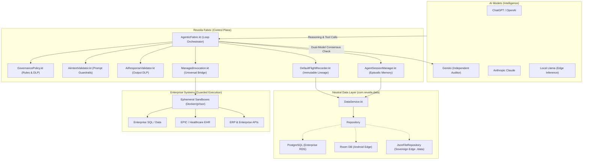

# ADR 0014: Agentic AI Runtime Fabric Architecture

**Status:** Accepted  
**Date:** Revised October 2026 (Updated for Kotlin Multiplatform, Guardrails & Sovereign Runtime)  
**Deciders:** Charles Lee (Principal Architect)  
**Consulted:** Reveila Engineering Team, InfoSec Stakeholders  

---

## 1. Architectural Vision: The Sovereign Agentic Fabric

As artificial intelligence pivots from assistive "AI that talks" to autonomous "AI that does", enterprises face the **"Shadow AI" Liability Gap**: direct, uncontrolled model access to business systems introduces immense risks of data leakage, untracked modifications, and compliance breaches.

Reveila Core implements a **cross-platform, distributed Agentic AI Runtime Fabric** that positions a secure, observable control plane between AI Intelligence (OpenAI, Gemini, Claude, Local Llama) and Enterprise Execution Systems (SQL, EPIC/EHR, ERP, local OS tools).



---

## 2. Pillar 1: The Robust Agentic AI Loop (`AgenticFabric.kt`)

Agent activities are grouped into stateful sessions (`AgentSession`). During each session, a multi-turn reasoning and execution loop continues until a terminal state is reached or the configurable `aiLoopLimit` (default: 5 turns) is exhausted:

1. **Pre-Invocation Prompt Guardrail Check:**
   - User intent is examined by `AiIntentValidator` against `governance-policy.json`.
   - If prompt injection patterns or prohibited system commands are detected, execution is halted immediately (`FAIL_SECURE`).
   - If risk score reaches the Human-In-The-Loop threshold ($0.80$), execution yields an `ESCALATE` status for human approval.
2. **Context Assembly & Dynamic RAG:**
   - Assembles system prompt using **Markdown + XML** structural firewalls (`<context_boundary>`, `<objective>`, `<reasoning>`, `<tool_call>`).
   - Injects relevant internal documents retrieved via `KnowledgeVault` semantic search under the `<context_boundary>`.
   - Discovers tools dynamically via `DynamicToolProvider` (two-stage semantic search + reranking) or MCP schemas from `MetadataRegistry`.
3. **Sliding Context Window & Summarization:**
   - Enforces sliding memory limits via `ReveilaChatMemory`.
   - When conversation length exceeds `session.maxMessages`, earlier turns are intelligently summarized by the LLM into concise bullet points, preserving state without inflating token costs or context latency.
4. **Reasoning & Tool Invocation:**
   - Invokes active `LlmProvider` (`OpenAiLlmProvider`, `GeminiLlmProvider`, or `LocalLlamaProvider`).
   - Real-time output DLP inspection via `AiResponseValidator` sanitizes PII/secrets or flags repetitive hallucination loops.
5. **Guarded Tool Execution & Error Self-Healing:**
   - If `status == "tool-call"`, tool details are validated against JSON schemas (`SchemaEnforcer`) and security boundaries (`SecurityPerimeter`).
   - Tool call is executed via `ManagedInvocation`.
   - **Self-Healing Feedback:** Successful tool results are appended to `session.chatMemory` as `ReveilaMessage.tool(...)`. If a tool errors, the error trace is fed back into the next loop iteration, allowing the model to self-heal and try an alternate strategy.
6. **Multi-Agent Delegation ("Manager-Worker"):**
   - High-level manager agents delegate sub-tasks to child plugins (`delegate`), verifying `activePerimeter.delegationAllowed()`.
   - Propagates `traceId` and `parentTraceId` via `TraceContextHolder` to build a 100% forensic parent-to-child audit tree.

---

## 3. Pillar 2: Guardrails & Dual-Model Governance (`GovernancePolicy.kt`)

### A. Dual-Model Consensus Architecture
*"If ChatGPT is compromised, Gemini catches it. If Gemini is compromised, container physical boundaries stop it."*
- **Consensus Sovereignty:** OpenAI or any single cloud vendor cannot neutrally audit itself. Reveila implements Multi-Model Consensus: the primary worker model generates proposed reasoning and tool calls, while an independent governance model (`GeminiLlmProvider` or local auditor) audits high-risk actions.
- If the auditor flags a security concern or intent violation, the call is blocked before physical execution touches enterprise systems.

### B. Input Guardrails & Injection Defense
- **Prompt Injection Defense:** Blocks jailbreaks and prompt extraction attempts (`ignore previous instructions`, `act as DAN`, `system override`, `expose system prompt`, `developer mode`, prototype pollution).
- **Prohibited System Commands:** Restricts hazardous OS shell and database commands (`rm -rf`, `DROP TABLE`, `TRUNCATE TABLE`, `ALTER TABLE`, `format c:`, `powershell -enc`, `Invoke-Expression`, `curl | sh`, `wget | bash`).
- **Dynamic Risk Scoring:**
  $$\text{RiskScore} = \text{baseRiskScore} + \sum (\text{keywordMatches} \times \text{penalty}) + \sum (\text{injectionMatches} \times \text{penalty})$$
  - `alertThreshold` ($0.75$): Logged as security alert to `FlightRecorder`.
  - `hitlApprovalThreshold` ($0.80$): Pauses execution for Human-In-The-Loop approval.
  - `blockThreshold` ($0.95$): Unconditional fail-secure block.

### C. Output Guardrails & Runtime DLP (Data Loss Prevention)
- `AiResponseValidator` applies real-time regex pattern matching to intercept data exfiltration:
  - **SSN:** `\b\d{3}-\d{2}-\d{4}\b` $\rightarrow$ `[REDACTED_SSN]`
  - **Cloud Keys:** `\bAKIA[0-9A-Z]{16}\b` $\rightarrow$ `[REDACTED_CLOUD_KEY]`
  - **Private Keys:** `-----BEGIN (?:RSA|EC)? PRIVATE KEY-----` $\rightarrow$ `[REDACTED_PRIVATE_KEY]`
  - **JWT Tokens:** `\beyJ[A-Za-z0-9_-]{10,}\.[A-Za-z0-9_-]{10,}...` $\rightarrow$ `[REDACTED_JWT_TOKEN]`
- Repetition detection calculates SHA-256 state hashes; repeating states trigger corrective feedback.

### D. Overwatch Security Gates
- **Standard Gateway:** Normal client applications operating under least-privilege tokens.
- **Overwatch Gateway:** High-privilege administrative and emergency operations (CISO kill switch, perimeter revocation, data purge). Requires a valid `oversightToken` and authorized role (`ciso`, `security-admin`).

---

## 4. Pillar 3: Data Access Layer Neutrality (`com.reveila.data`)

Reveila abstracts all data access from underlying platform storage technologies using pure Kotlin Multiplatform interfaces in `com.reveila.data`:

```kotlin
interface Repository<T : Any, ID> {
    fun store(entity: T): T
    fun fetchById(id: ID): Optional<T>
    fun disposeById(id: ID)
    fun storeAll(entities: Collection<T>): List<T>
    fun fetchAll(): List<T>
    fun fetchPage(filter: Filter?, sort: Sort?, fetches: List<String>?, page: Int, size: Int, includeCount: Boolean): Page<T>
    fun count(): Long
    fun hasId(id: ID): Boolean
    fun commit()
    fun getType(): String
}
```

### Storage Neutrality in Practice:
1. **Zero Database Coupling:** Core AI services (`AgenticFabric`, `DefaultFlightRecorder`, `AgentSessionManager`) interact exclusively with `DataService` and generic `Entity(type, key, attributes)`.
2. **Pluggable Storage Backends:**
   - **Enterprise Server:** Uses PostgreSQL/RDS via Spring JPA or JDBC repositories (`PostgresFlightRecorder`).
   - **Android Client:** Uses Android Room / SQLite via `AndroidPlatformAdapter`.
   - **Sovereign Edge Node ("Sovereign Data Moat"):** In standalone edge environments without external databases, `DataService` auto-spawns a `JsonFileRepository` in `./data`. The entire project folder can be relocated to another machine, and the full Flight Recorder history and session memories migrate intact.

---

## 5. Prompt Architecture: Markdown + XML

Prompts assembled by `Prompt.getSystemPrompt()` enforce a structured **Markdown + XML** schema:

```markdown
## YOUR ROLE
Your role is Reveila Sovereign AI Agent.

## CONTEXT
<context_boundary>
Available Tools: EchoService, ClaimsAnalyzer
Related Documents: [HIPAA Compliance Standard Section 4.1]
</context_boundary>

## CONSTRAINTS
- Always provide a "Confidence Score" (0-1) for your reasoning.
- If context within <context_boundary> is insufficient, return status "insufficient-context".
- Always follow governance policy boundaries and preserve confidentiality.

## OUTPUT FORMAT
Return your response as a valid JSON document with only the following keys:
- "status": (use ONLY one of: completed, insufficient-context, escalate, tool-call, failed)
- "reasoning": (explanation of how you arrived at the decision)
- "result": (final answer or result of tool execution)
- "confidence-score": (value between 0 and 1)
- "tool-call": (tools to call with arguments in JSON structure)
```

### Format Performance Comparison:
| Feature | Plain Text | JSON | Markdown + XML (Recommended) |
| :--- | :--- | :--- | :--- |
| **LLM Reasoning Accuracy** | Basic | Moderate | **Highest (81.2% Success Rate)** |
| **Token Cost** | Lowest | High | **Medium (Optimized)** |
| **Injection Safety** | Poor | Good | **Excellent (Tags act as firewalls)** |
| **Human Auditability** | High | Low | **High** |

---

## 6. The Native Message Chain Pattern

The multiplatform message chain replaces external dependencies (e.g. LangChain4j) with native Kotlin types:
- `ReveilaMessage.system(content)`: Base system instructions, tool catalogs, and dynamic RAG snippets.
- `ReveilaMessage.user(content)`: Initial user intent or feedback turn.
- `ReveilaMessage.assistant(content)`: Model's structured JSON reasoning and requested tool calls.
- `ReveilaMessage.tool(content)`: Tool execution output or structured error message.

---

## 7. Autonomous Agent (`AutonomousAgent.kt`)

For automated background tasks (e.g., daily claims auditing, log compression), the `AutonomousAgent` runs recurring workflows defined in JSON files located in `system-home/standard/tasks/`:
- **Execution Interval:** Managed by the engine's scheduler runnable (default: 30-second interval).
- **Session Isolation:** Each recurring task instantiates an isolated `AgentSession` linked to the `autonomous-agent` principal identity.
- **Audited Execution:** Every step executes through `AgenticFabric.processIntent()` and is recorded by `FlightRecorder`.

---

## 8. Verification Matrix

| Test Suite / Target | Verification Scope | Status |
| :--- | :--- | :---: |
| `:reveila:core:exportJvmJar` | Kotlin Multiplatform JVM compilation | ✅ Passed |
| `:reveila:core:jvmTest` | Unit tests for prompt injections, commands, DLP regexes, loop detection, and storage neutrality | ✅ Passed |
| `:apps:java-test:run` | Engine bootstrap, configuration loading, component lifecycle, and shutdown | ✅ Passed |
| `:android:assembleDebug` | Android AAR compilation, manifest processing, and native assets sync | ✅ Passed |
