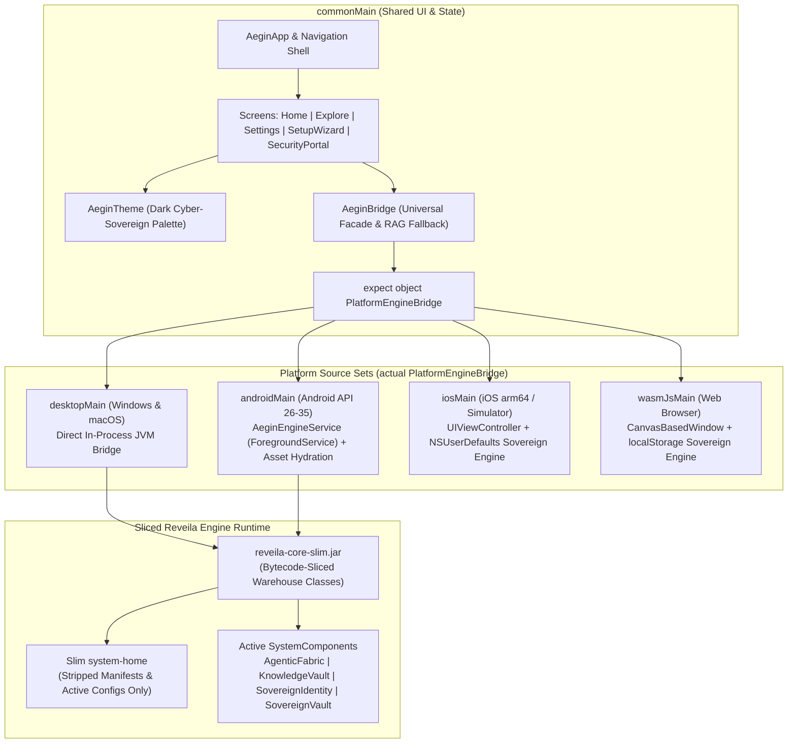
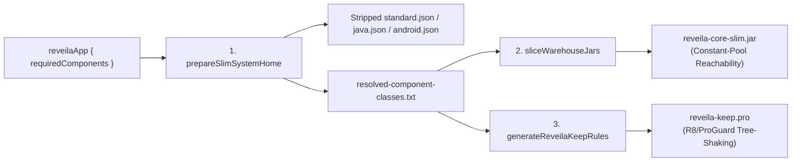

# ADR 0021: Multi-Platform App Architecture and Development Guide (Aegin Standard)

**Status:** Accepted & Implemented  
**Reference Implementation:** `:apps:Aegin` (`apps/Aegin`)  
**Build Convention Plugin:** `reveila-app-packager` (`build-logic/src/main/kotlin/reveila-app-packager.gradle.kts`)

---

## 1. Context & Architectural Motivation

`Reveila-Suite` acts as a comprehensive **features warehouse**: the `reveila:core` engine, `system-home` distribution, and root monorepo house a broad collection of system components, AI runtimes (`llama-server`, `llama-cli`), database engines, web assets, and utility libraries. While this "batteries-included" warehouse accelerates rapid prototyping, bundling the entire warehouse into a fat binary is prohibitive for resource-constrained targets such as mobile phones, foldables, smartwatches, and web clients.

At the same time, maintaining separate UI codebases per platform (e.g., React Native / Expo for mobile alongside separate desktop or web shells) introduces bridge duplication, serialization overhead, and divergent UI behavior.

To solve both problems, project **Aegin**, located at `apps/Aegin`) establishes the standard **Kotlin Multiplatform (KMP) + Compose Multiplatform** application architecture for `Reveila-Suite`:

1. **Single Shared UI & State Layer (`commonMain`)**: 100% of screens, themes, navigation, onboarding flows, and business state are authored once in Kotlin with Compose Multiplatform, targeting **Windows**, **macOS**, **Android**, **iOS**, and **Web (`wasmJs`)**.
2. **Direct In-Process JVM/Android Execution**: On Windows, macOS, and Android, the UI communicates directly in-process with `com.reveila.Reveila` and `SystemComponents` without JSON-RPC or React Native JNI serialization bottlenecks.
3. **Selective Warehouse Slicing (`reveila-app-packager`)**: Every multiplatform app declares only the `SystemComponent` keys it actually uses via the `reveilaApp { ... }` Gradle DSL. At build time, `reveila-app-packager` computes the transitive closure of required components, strips unused `system-home` binaries and assets, performs JVM constant-pool bytecode reachability analysis to slice warehouse JARs, and generates targeted R8/ProGuard `-keep` rules.

---

## 2. Multi-Platform Architecture Overview



### 2.1 Source Set & Target Distribution

| Source Set | Targets | Engine Execution Model | Persistence Mechanism | Entry Point |
| :--- | :--- | :--- | :--- | :--- |
| `commonMain` | All Platforms | Platform-agnostic via `AeginBridge` | Delegated to `PlatformEngineBridge` | `AeginApp()` `@Composable` |
| `desktopMain` | Windows (`msi`/`exe`), macOS (`dmg`) | In-process `Reveila` singleton over sliced `reveila-core-slim.jar` | `~/.reveila/aegin/prefs.properties` | `com.reveila.aegin.MainKt` (`main()`) |
| `androidMain` | Android Phones, Tablets, Wearables | Foreground `AeginEngineService` + in-process `Reveila` singleton | `SharedPreferences` (`aegin_sovereign_prefs`) + hydrated `filesDir/system-home` | `MainActivity` + `AeginEngineService` |
| `iosMain` | iOS Devices (`iosArm64`) & Simulators | Embedded Sovereign Node runtime | `NSUserDefaults.standardUserDefaults` | `MainViewController()` |
| `wasmJsMain` | Web Browsers (WebAssembly) | Browser Sandbox Sovereign Node runtime | `kotlinx.browser.localStorage` | `main()` (`CanvasBasedWindow`) |

---

## 3. Project Directory Structure (`apps/Aegin`)

All multiplatform apps under `Reveila-Suite/apps/<AppName>` follow the directory layout established by `apps/Aegin`:

```text
apps/Aegin/
├── build.gradle.kts                 # KMP targets + reveila-app-packager DSL configuration
├── proguard-rules.pro               # Base R8/ProGuard rules (supplemented by generated reveila-keep.pro)
└── src/
    ├── commonMain/kotlin/com/reveila/aegin/
    │   ├── bridge/
    │   │   └── AeginBridge.kt       # Universal bridge API + expect PlatformEngineBridge + Data models
    │   └── ui/
    │       ├── AeginApp.kt          # Root @Composable shell, bottom nav, modal orchestration
    │       ├── theme/
    │       │   └── AeginTheme.kt    # Color palette, typography, cyber-sovereign surface tokens
    │       ├── components/
    │       │   └── SetupWizard.kt   # 4-step first-boot onboarding modal
    │       └── screens/
    │           ├── HomeScreen.kt    # Engine status card, sovereign chat, vault badge, message bubbles
    │           ├── ExploreScreen.kt # Component invoke console, vault scanner, SecurityPortalModal
    │           └── SettingsScreen.kt# Tabbed settings (General, Security, Advanced) + Setup re-run
    ├── desktopMain/kotlin/com/reveila/aegin/
    │   ├── Main.kt                  # Desktop Compose Window + --verify-headless CLI runner
    │   └── bridge/
    │       └── PlatformEngineBridge.desktop.kt
    ├── androidMain/
    │   ├── AndroidManifest.xml      # Foreground service permissions + MainActivity + AeginEngineService
    │   └── kotlin/com/reveila/aegin/
    │       ├── MainActivity.kt
    │       ├── AeginEngineService.kt
    │       └── bridge/
    │           └── PlatformEngineBridge.android.kt
    ├── iosMain/kotlin/com/reveila/aegin/
    │   ├── MainViewController.kt
    │   └── bridge/
    │       └── PlatformEngineBridge.ios.kt
    └── wasmJsMain/
        ├── kotlin/com/reveila/aegin/
        │   ├── main.kt
        │   └── bridge/
        │       └── PlatformEngineBridge.wasmJs.kt
        └── resources/
            └── index.html
```

---

## 4. Selective Warehouse Packaging & Bytecode Slicing (`reveila-app-packager`)

The core innovation for keeping release binaries small on mobile and wearable targets is the **`reveila-app-packager`** Gradle convention plugin (`build-logic/src/main/kotlin/reveila-app-packager.gradle.kts`).

### 4.1 Three-Stage Slicing Pipeline



#### Stage 1: `prepareSlimSystemHome` (`PrepareSlimSystemHomeTask`)
- Parses `system-home/standard/configs/shared/standard.json` and platform manifests (`java.json`, `android.json`).
- Computes the **transitive dependency closure** starting from `reveilaApp.requiredComponents` (automatically including core bootstrap services `SystemControl`, `Logger`, `Config`, and `DiagnosticService`).
- Writes stripped JSON manifests containing *only* the reachable `SystemComponent` definitions.
- Excludes warehouse bloat from the packaged `system-home`:
  - Native desktop LLM server binaries (`bin/llama/*` — ~38 MB saved on mobile)
  - Unused web bundles (`web/assets/*`)
  - Warehouse sample images (`resources/images/*.png`)
  - Embedded database snapshots (`data/postgres/*`)
  - Inactive configuration templates (`configs/unused/*`)
  - Unreferenced plugin JARs (`plugins/*.jar`)
- Emits `build/reveila-slim/resolved-component-classes.txt` listing the fully qualified class names of all active `SystemComponent` implementations.

#### Stage 2: `sliceWarehouseJars` (`SliceWarehouseJarsTask`)
- Reads `distribution/jvm/reveila-core.jar` and any additional JARs declared in `warehouseJars`.
- Parses every `.class` file's **JVM Constant Pool (`0xCAFEBABE`)**:
  - Extracts `CONSTANT_Class` (`tag = 7`) references.
  - Parses UTF-8 class/method/field descriptors (`Lpackage/ClassName;`) to capture parameter types, return types, generic signatures, and annotations.
  - Automatically retains same-package inner/companion classes (`Outer$Inner`) when `Outer` is reachable.
- Computes the transitive class reachability graph starting from `com.reveila.Reveila`, core runtime entry points, and `resolved-component-classes.txt`.
- Emits `build/reveila-slim/libs/reveila-core-slim.jar` containing *only* reachable bytecode and writes a human-readable audit log to `build/reveila-slim/slicing-report.txt`.

#### Stage 3: `generateReveilaKeepRules` (`GenerateReveilaKeepRulesTask`)
- Because `Reveila` instantiates `SystemComponent` classes reflectively from JSON manifests, naive R8 rules previously had to `-keep class com.reveila.** { *; }`, preventing R8 from shrinking anything in `reveila:core`.
- `generateReveilaKeepRules` generates `build/reveila-slim/reveila-keep.pro` with exact `-keep class <fqcn>` rules **only** for the active components in `resolved-component-classes.txt`, allowing R8 to aggressively tree-shake and inline the rest of the codebase.

### 4.2 Aegin Slicing Benchmark Results

| Metric | Unconstrained Warehouse | Aegin Sliced Build (`reveila-app-packager`) | Reduction / Impact |
| :--- | :--- | :--- | :--- |
| **`system-home` Payload** | ~38.4 MB (includes `llama` binaries, web assets, unused configs) | **< 25 KB** (4 active JSON manifests + sovereign architecture doc) | **> 99.9% smaller** |
| **Warehouse Classes (`reveila-core`)** | 244 `.class` entries (`523,907` bytes) | **194 `.class` entries (`431,514` bytes)** | **50 unused warehouse classes pruned (17.6% raw bytecode cut)** |
| **Android Release APK (`Aegin-release.apk`)** | Fat multi-megabyte bundle | **1.21 MB (`1,270,254` bytes)** (Full Compose UI + Sliced Core + R8) | Ideal for mobile phones & smartwatches |
| **Windows Slim Distribution (`Aegin-windows-slim`)** | Full warehouse runtime | **~18.9 MB** (Compose Desktop Skiko + Coroutines + `reveila-core-slim.jar`) | Self-contained `.bat` + slim `system-home` |

---

## 5. Universal Multiplatform Bridge (`AeginBridge`)

All UI screens in `commonMain` interact with the Reveila engine exclusively through `com.reveila.aegin.bridge.AeginBridge` (`apps/Aegin/src/commonMain/kotlin/com/reveila/aegin/bridge/AeginBridge.kt`).

### 5.1 Contract Specification

```kotlin
expect object PlatformEngineBridge {
    fun startService(systemHomeOverride: String = ""): Boolean
    fun getEngineStatus(): EngineStatus
    fun invoke(component: String, method: String, argsJson: String = "[]"): String
    fun scanDirectory(path: String): List<VaultFileEntry>
    fun readTextFile(path: String): String?
    fun getDefaultVaultPath(): String
    fun loadSetting(key: String, defaultValue: String): String
    fun saveSetting(key: String, value: String)
    fun platformName(): String
}
```

### 5.2 High-Level Operations Provided by `AeginBridge`

1. **Lifecycle & Diagnostics**:
   - `startService()`: Boots `Reveila.start()` on Desktop/Android (and initializes the foreground `AeginEngineService` on Android).
   - `getEngineStatus()`: Returns `EngineStatus(running, state, bootDurationMs, systemHome, loadedComponents, platform)`.
2. **Reflective Component Invocation**:
   - `invoke(component, method, args)`: Invokes any active `SystemComponent` method in-process on JVM/Android using JSON-serialized arguments and returns a JSON response payload.
3. **Sovereign RAG & Agentic Querying (`askAgent`)**:
   - Calls `AgenticFabric.askAgent(prompt, clearance)` first.
   - If the response indicates no local matches or `KnowledgeVault` has not yet indexed the active vault directory, `AeginBridge` automatically triggers `syncVaultDirectory()` to ingest `.md`, `.txt`, `.json`, `.kt`, and `.log` files into `KnowledgeVault.ingestDocument(docId, title, content, tags)` and re-queries `KnowledgeVault.search(prompt, 3)`.
4. **Cross-Platform Settings Synchronization**:
   - `loadSettings()` / `saveSettings(AppSettings)` persists `AppSettings` across restarts and synchronizes runtime parameters (`vaultPath`, `accessControlLevel`, `localInferenceModel`, `maxMemoryMb`, `biometricLock`, `zeroTelemetry`, `hardwareAcceleration`) into `SovereignVault` and `AgenticFabric`.

---

## 6. Standard UI Screens & Functional Flows

`Aegin` replicates and unifies all capabilities from `apps/expo` into five cohesive Compose Multiplatform views:

1. **4-Step First-Boot Setup Wizard (`SetupWizard.kt`)**:
   - **Step 1 (Welcome)**: Introduces the Aegin Sovereign Node and active platform runtime.
   - **Step 2 (Sovereign Vault Directory)**: Configures the local folder path monitored by `KnowledgeVault` with quick-preset selectors and live directory scanning.
   - **Step 3 (AI & Resource Guardrails)**: Selects the local LLM profile (`Llama-3.2-1B-Instruct-Q4_K_M`, `Qwen-2.5-1.5B-Instruct-Q4`, `Phi-3.5-Mini-Instruct-Q4`) and caps maximum RAM allocation (`1024 MB` – `4096 MB`).
   - **Step 4 (Sovereign Security Shield)**: Configures Biometric/Passkey Lock, Strict Zero-Telemetry (`127.0.0.1` loopback enforcement), and Hardware Acceleration (Vulkan / Metal / NPU).
2. **Home Screen (`HomeScreen.kt`)**:
   - Displays a real-time **Engine Telemetry Header** (`RUNNING`/`STOPPED`, boot time in `ms`, active component count, quick `Sync Vault` action, and active Vault directory pill).
   - Provides the **Sovereign Agentic Chat Console** with interactive suggestion chips, clearance metadata badges, and source document attribution from `KnowledgeVault`.
3. **Explore & Component Console (`ExploreScreen.kt`)**:
   - Lists active `SystemComponents` (`AgenticFabric`, `KnowledgeVault`, `SovereignIdentity`, `SovereignVault`), quick-fill invocation presets, custom component/method/JSON argument inputs, and formatted JSON output inspection.
   - Displays live **KnowledgeVault Indexed Documents** with one-click vault re-indexing.
4. **Sovereign Security Portal Modal (`SecurityPortalModal` in `ExploreScreen.kt`)**:
   - Full-screen diagnostic modal inspecting `SovereignIdentity` node identity, clearance tiers (`SOVEREIGN_ACCESS_CONTROL_v2`, `SOVEREIGN_STRICT_LOCAL`, `SOVEREIGN_PARANOID_AIRGAP`), and network/telemetry lockdown state.
5. **Settings Screen (`SettingsScreen.kt`)**:
   - Organized into **General**, **Security**, and **Advanced** tabs with live persistence, plus a **Re-run Setup Wizard** action in the header.

---

## 7. Developer Guide: Creating a New Multi-Platform App from the Aegin Template

Follow this step-by-step guide whenever creating a new multiplatform application in `Reveila-Suite/apps/<NewApp>`.

### Step 1: Register the Subproject in `settings.gradle.kts`

Add your project entry in the root `settings.gradle.kts`:

```kotlin
include(":apps:MyNewApp")
project(":apps:MyNewApp").projectDir = file("apps/MyNewApp")
```

### Step 2: Configure `apps/MyNewApp/build.gradle.kts` with `reveila-app-packager`

Apply the Kotlin Multiplatform, Compose Multiplatform, Android Application, and **`reveila-app-packager`** plugins, then declare **only** the `SystemComponent` keys your app needs inside the `reveilaApp { ... }` block:

```kotlin
plugins {
    alias(libs.plugins.kotlin.multiplatform)
    alias(libs.plugins.android.application)
    alias(libs.plugins.jetbrains.compose)
    alias(libs.plugins.compose.compiler)
    id("reveila-app-packager")
}

reveilaApp {
    appName.set("MyNewApp")
    // Declare ONLY the components your app uses from the Reveila warehouse.
    // Transitive component dependencies and core bootstrap services are resolved automatically.
    requiredComponents.set(
        listOf(
            "AgenticFabric",
            "KnowledgeVault",
            "SovereignIdentity",
            "SovereignVault"
        )
    )
    includeWebAssets.set(false)
    includeLlamaBinaries.set(false)
    includeSampleImages.set(false)
    includePostgresData.set(false)
}
```

### Step 3: Wire the Sliced JAR into `desktopMain` and `androidMain`

Point `desktopMain` and `androidMain` dependencies to the sliced `build/reveila-slim/libs/reveila-core-slim.jar` generated by `sliceWarehouseJars` rather than the full warehouse project:

```kotlin
val slimCoreJarProvider = layout.buildDirectory.file("reveila-slim/libs/reveila-core-slim.jar")

kotlin {
    jvm("desktop")
    androidTarget()
    iosX64(); iosArm64(); iosSimulatorArm64()
    @OptIn(org.jetbrains.kotlin.gradle.ExperimentalWasmDsl::class)
    wasmJs { browser() }

    sourceSets {
        val desktopMain by getting {
            dependencies {
                implementation(files(slimCoreJarProvider))
            }
        }
        val androidMain by getting {
            dependencies {
                implementation(files(slimCoreJarProvider))
            }
        }
    }
}
```

### Step 4: Configure Android R8 to Use the Generated `reveila-keep.pro`

In the `android { ... }` block of `build.gradle.kts`, enable `isMinifyEnabled = true` and `isShrinkResources = true`, and pass the generated `build/reveila-slim/reveila-keep.pro` alongside your base `proguard-rules.pro`:

```kotlin
android {
    buildTypes {
        getByName("release") {
            isMinifyEnabled = true
            isShrinkResources = true
            proguardFiles(
                getDefaultProguardFile("proguard-android-optimize.txt"),
                "proguard-rules.pro",
                layout.buildDirectory.file("reveila-slim/reveila-keep.pro").get().asFile
            )
            signingConfig = signingConfigs.getByName("debug")
        }
    }
}
```

### Step 5: Adding or Extending a Warehouse `SystemComponent`

If your app requires new backend capabilities in `reveila:core`:
1. Implement `com.reveila.component.SystemComponent` in `reveila/core/src/commonMain/kotlin/...`.
2. Register the component key, class name, and `"dependencies": [...]` in `system-home/standard/configs/shared/standard.json` (or platform-specific `java.json` / `android.json`).
3. Rebuild the core warehouse JAR (`.\gradlew.bat :reveila:core:copyJarToDist`).
4. Add the component key to `requiredComponents` in your app's `reveilaApp { ... }` block.
5. Call `AeginBridge.invoke("YourComponentKey", "yourMethod", "[\"arg1\"]")` from `commonMain` UI code.

---

## 8. Build, Run & Verification Reference Commands

All commands are executed from the `Reveila-Suite` root directory (`C:\IDE\Projects\Reveila-Suite`):

| Target / Workflow | Gradle Command | Output / Artifact Path |
| :--- | :--- | :--- |
| **Inspect Warehouse Slicing Report** | `.\gradlew.bat :apps:Aegin:prepareSlimSystemHome :apps:Aegin:sliceWarehouseJars` | `apps/Aegin/build/reveila-slim/slicing-report.txt` |
| **Build Android Slim Release APK** | `.\gradlew.bat :apps:Aegin:assembleRelease` | `apps/Aegin/build/outputs/apk/release/Aegin-release.apk` (`1.21 MB`) |
| **Build Windows Slim Portable Distribution** | `.\gradlew.bat :apps:Aegin:packageSlimWindowsDist` | `apps/Aegin/build/reveila-slim/windows-dist/Aegin-windows-slim/` |
| **Run Desktop App (Windows / macOS)** | `.\gradlew.bat :apps:Aegin:run` | Launches interactive Compose Desktop window |
| **Run Headless E2E Engine Verification** | `java -Dsystem.home=apps/Aegin/build/reveila-slim/windows-dist/Aegin-windows-slim/system-home -cp "apps/Aegin/build/reveila-slim/windows-dist/Aegin-windows-slim/lib/*" com.reveila.aegin.MainKt --verify-headless` | Verifies `Reveila` boot, `KnowledgeVault` ingestion, and `AgenticFabric` RAG |
| **Compile Web (`wasmJs`) Target** | `.\gradlew.bat :apps:Aegin:compileKotlinWasmJs` | `apps/Aegin/build/compileSync/wasmJs/main/productionExecutable/kotlin/` |
| **Package Native Desktop Installers** | `.\gradlew.bat :apps:Aegin:packageDistributionForCurrentOS` | Native `.msi` / `.exe` (Windows) or `.dmg` (macOS) |
