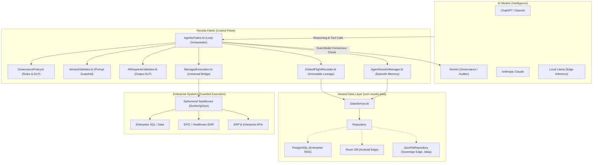

# ADR 0023: Agentic AI Runtime Fabric and Sovereign Governance

**Status:** Accepted  
**Date:** October 2026  
**Deciders:** Charles Lee (Founder & Chief Architect)  
**Consulted:** InfoSec Stakeholders, Enterprise Architecture Team  

---

## 1. Context and Problem Statement

As artificial intelligence pivots from "AI that talks" to "AI that does", enterprise adoption faces the **"Shadow AI" Liability Gap**:
- Direct model invocation against business systems creates multi-billion-dollar risks of unintended data exfiltration, unconstrained tool execution, and regulatory non-compliance (HIPAA, GDPR, EU AI Act).
- LLM providers cannot neutrally audit themselves ("The Fox Guarding the Henhouse" fallacy).
- Enterprises cannot send full system context or private customer credentials to third-party cloud monitoring.

The **Reveila Agentic AI Runtime Fabric** acts as an **Operating System for the agentic workforce**, positioning a guarded control plane between AI Intelligence (OpenAI, Gemini, Claude, Local Llama) and Enterprise Execution Systems (SQL, EPIC/EHR, ERP).

---

## 2. Core Architecture & Requirements

---

## 3. Pillar 1: Robust Agentic AI Loop (`AgenticFabric.kt`)

The runtime loop coordinates multi-turn reasoning with deterministic safety controls:
1. **Dynamic Prompt Assembly (Markdown + XML):**
   - Utilizes `<context_boundary>`, `<objective>`, `<reasoning>`, `<tool_call>`, and `<tool_response>` structural firewalls to prevent prompt injections.
   - Dynamically retrieves enterprise context from `KnowledgeVault` RAG.
2. **Pre-Invocation Guardrail Examination:**
   - Every user prompt is evaluated by `AiIntentValidator` against `governance-policy.json`.
   - Dynamic risk scoring ($Risk = \text{base} + \sum \text{penalties}$) checks against configurable alert, HITL escalation, and fail-secure block thresholds.
3. **Sliding Context Window & Summarization:**
   - When conversation history approaches max token bounds, older turns are compacted into concise summaries while preserving active system context and recent messages.
4. **Tool Execution & Feedback:**
   - Invocation via `ManagedInvocation` validates schemas (`SchemaEnforcer`), verifies perimeters (`SecurityPerimeter`), redacts secrets, and runs inside ephemeral sandboxes.
   - Successful results are appended to `ReveilaChatMemory` as `ReveilaMessage.tool(...)`.
   - Tool errors are fed back into the reasoning loop, allowing the model to self-correct and formulate alternative execution plans.
5. **Multi-Agent Delegation ("Manager-Worker"):**
   - Manager plugins delegate sub-tasks to child plugins (`delegate`), propagating `traceId` and `parentTraceId` through `TraceContextHolder`.
   - Verifies `activePerimeter.delegationAllowed()`.

---

## 4. Pillar 2: Dual-Model Governance & Guardrails (`GovernancePolicy.kt`)

1. **Dual-Model Consensus ("If ChatGPT is compromised, Gemini catches it"):**
   - For high-risk operations or elevated risk scores, `AiIntentValidator` triggers an independent audit using a secondary model provider (e.g., Gemini auditing OpenAI).
2. **Prompt Injection & Command Defense:**
   - Strict pattern matching against instruction overrides (`ignore previous instructions`, `act as DAN`, `jailbreak`, `expose system prompt`) and destructive commands (`rm -rf`, `DROP TABLE`, `format c:`, `powershell -enc`).
3. **Runtime Data Loss Prevention (DLP):**
   - `AiResponseValidator` scans model outputs for PII, SSNs (`\d{3}-\d{2}-\d{4}`), credit cards, cloud credentials (`AKIA...`), JWT tokens, and private keys.
   - Redacts sensitive leaks into tokens (`[REDACTED_SSN]`, `[REDACTED_CLOUD_KEY]`) or terminates execution if an exfiltration threshold is breached.
4. **Repetition & Hallucination Defense:**
   - SHA-256 state tracking flags loop repetitions and feeds corrective prompts back to the agent.
5. **Overwatch Security Gates & Kill Switch:**
   - Standard Gateway: Standard user/tenant operations within scoped perimeters.
   - Overwatch Gateway: High-privilege operations (emergency lockdown, global kill switch, perimeter overrides) requiring an authentic `oversightToken` and authorized role (`ciso`, `security-admin`).

---

## 5. Pillar 3: Data Access Layer Neutrality (`com.reveila.data`)

1. **Hexagonal Data Architecture:**
   - `DataService` and `Repository<Entity, ID>` abstract all persistence from concrete storage drivers.
   - All AI session persistence (`AgentSessionManager`) and forensic flight recording (`DefaultFlightRecorder`) strictly consume `Entity` and `DataService`.
2. **Pluggable & Infrastructure Agnostic:**
   - **Enterprise Cloud:** Backed by enterprise PostgreSQL/RDS via `PostgresFlightRecorder` or Spring JPA repository.
   - **Mobile Edge:** Backed by SQLite / Room via `AndroidPlatformAdapter`.
   - **Sovereign Local Edge:** When running standalone or in disconnected edge environments, `DataService` auto-spawns a `JsonFileRepository` writing to `./data`. The entire project folder can be migrated to any host, and flight recorder history moves with it ("Sovereign Data Moat").

---

## 6. Verification & Quality Assurance

- **Multiplatform JVM Jar Export:** `gradlew :reveila:core:exportJvmJar` succeeded.
- **Java Runtime Verification:** `gradlew :apps:java-test:run` passed end-to-end initialization, config validation, multi-component lifecycle, and graceful shutdown.
- **Automated Tests:** `gradlew :reveila:core:jvmTest` passed all tests in `AgenticFabricGovernanceTest`:
  - Prompt injection pattern blocking.
  - Prohibited command blocking (`rm -rf`).
  - DLP response scrubbing (`[REDACTED_SSN]`, `[REDACTED_CLOUD_KEY]`).
  - Repetition and echo loop detection.
  - Sovereign repository storage neutrality.
- **Android Native Compilation:** `gradlew :android:assembleDebug` passed cleanly.
