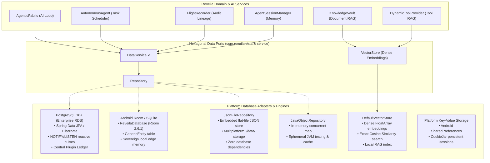
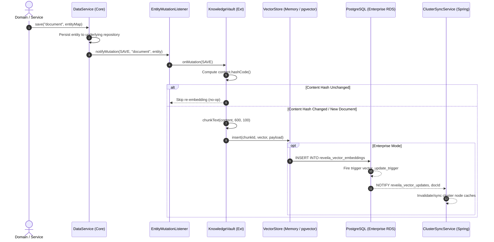
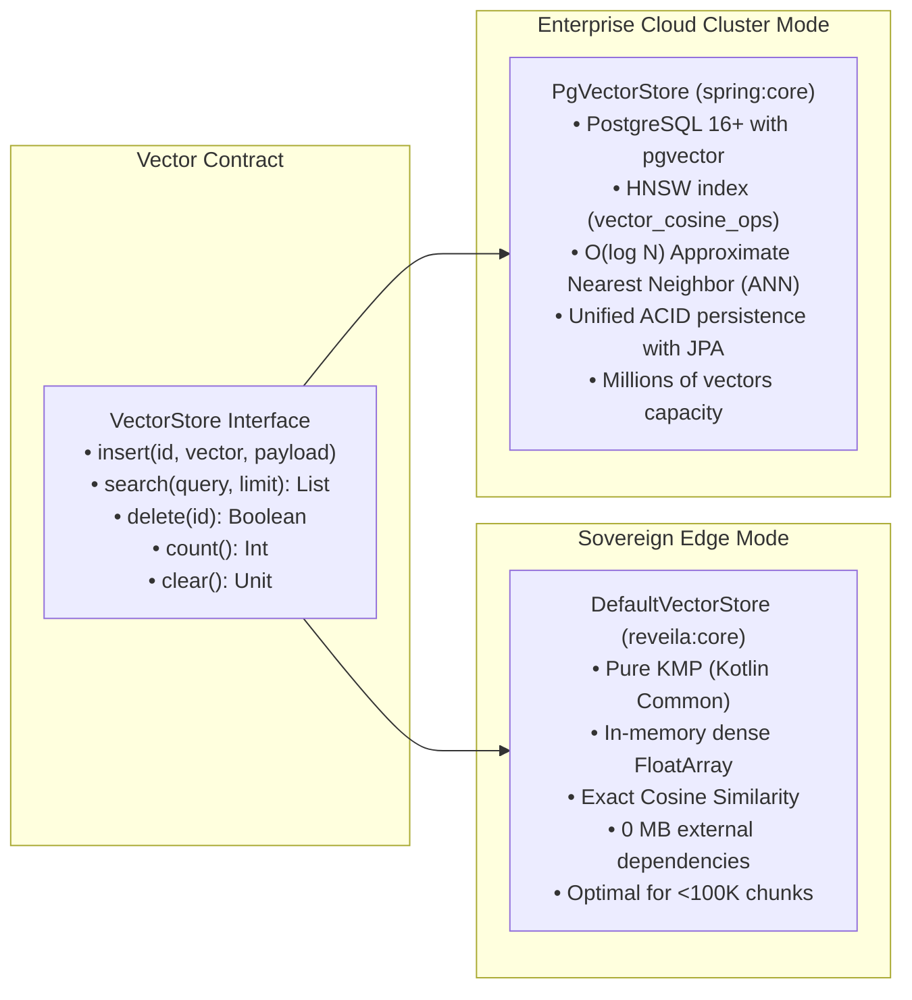

# ADR 0024: Database Architecture & Sovereign Persistence Strategy

**Status:** Accepted  
**Date:** November 2026  
**Deciders:** Charles Lee (Founder & Chief Architect)  
**Consulted:** Core Architecture Team, InfoSec Stakeholders  

---

## 1. Context and Problem Statement

The Reveila-Suite operates across diverse deployment targets with radically different infrastructure constraints:
1. **Enterprise Cloud Clusters (Spring Boot):** Require high-concurrency relational data integrity, centralized plugin registries, reactive cross-node cache invalidation, and audited flight recorder ledgers.
2. **On-Device Mobile Edge (Android & Wearables):** Require 100% offline "sovereign memory"—private local storage where sensitive user data, agent thoughts, and audit trails remain on the physical device without leaking to cloud servers.
3. **Embedded & Desktop Environments (Desktop Native, Windows, macOS, Linux):** Require zero-dependency, self-contained persistence without requiring users to install or manage background database daemons (e.g., PostgreSQL or MySQL).
4. **Agentic AI & RAG Subsystems:** Require fast, dense vector similarity search to perform Retrieval-Augmented Generation (RAG) and semantic tool discovery ("Tool RAG") across arbitrary hardware targets.

To satisfy these requirements without fragmenting core business logic, Reveila implements a **Hexagonal Persistence Strategy** where the engine and AI services remain completely agnostic of the underlying database engine.

---

## 2. Persistence Architecture Topology



---

## 3. Database Technologies in Reveila-Suite

### 3.1 PostgreSQL (Enterprise Server Ledger & Reactive Pulses)
* **Target:** Enterprise Server (`spring:core`).
* **Implementation:** PostgreSQL 16+ backed by Spring Boot Data JPA, Hibernate (`PostgreSQLDialect`), and Docker Compose containerization (`${REVEILA_HOME}/data/postgres`).
* **Key Capabilities:**
  * **Sovereign Plugin Ledger:** Centralized store for authorized plugin manifests (`plugin_registry`) and enterprise runtime settings (`global_settings`).
  * **Reactive Config Pulses (`NOTIFY/LISTEN`):** Whenever an administrator alters plugin configurations or security perimeters, a database trigger broadcasts on channel `reveila_config_updates`. Distributed Reveila nodes listen via [`ClusterSyncService`](file:///c:/IDE/Projects/Reveila-Suite/spring/core/src/main/java/com/reveila/spring/service/ClusterSyncService.java) and refresh properties instantaneously with zero downtime.
  * **Enterprise Flight Recorder:** Stores immutable audit traces of model reasoning, security perimeter checks, and tool executions.

### 3.2 SQLite via Android Jetpack Room (`ReveilaDatabase`)
* **Target:** Android Mobile Edge ([`android`](file:///c:/IDE/Projects/Reveila-Suite/android)).
* **Implementation:** [`ReveilaDatabase.java`](file:///c:/IDE/Projects/Reveila-Suite/android/src/main/java/com/reveila/android/db/ReveilaDatabase.java) / [`GenericDao.java`](file:///c:/IDE/Projects/Reveila-Suite/android/src/main/java/com/reveila/android/db/GenericDao.java) powered by Android Jetpack Room (`androidx.room:room-runtime:2.6.1`).
* **Key Capabilities:**
  * **Sovereign Personal Memory:** Anchors the principle defined in [ADR 0011](file:///c:/IDE/Projects/Reveila-Suite/memory-bank/ADR/0011%20UX%20Personal%20Edition.md): *"My memory is an SQLite file on my phone."*
  * **Generic Entity Mapping:** Persists arbitrary `GenericEntity` records (entity type, unique key, JSON attributes, timestamps) to a local SQLite database (`reveila_database.db`).
  * **Offline Resilience:** Allows on-device agents to query historic session data, retrieve audit logs, and maintain task schedules without an internet connection.

### 3.3 Dense In-Memory Vector Database (`DefaultVectorStore`)
* **Target:** Cross-platform (`reveila:core` & `reveila:ext`).
* **Implementation:** [`DefaultVectorStore.kt`](file:///c:/IDE/Projects/Reveila-Suite/reveila/core/src/commonMain/kotlin/com/reveila/persistence/DefaultVectorStore.kt) implementing [`VectorStore.kt`](file:///c:/IDE/Projects/Reveila-Suite/reveila/core/src/commonMain/kotlin/com/reveila/persistence/VectorStore.kt).
* **Key Capabilities:**
  * **Pure Multiplatform:** Zero external C++ or third-party vector DB dependencies; runs seamlessly on Android ART, JVM, iOS, and Desktop.
  * **Cosine Similarity Retrieval:** Computes normalized dot products over dense `FloatArray` embedding vectors.
  * **Document RAG Indexing:** Powers [`KnowledgeVault.kt`](file:///c:/IDE/Projects/Reveila-Suite/reveila/ext/src/commonMain/kotlin/com/reveila/ai/KnowledgeVault.kt) to chunk, index, and retrieve reference documents from the local user vault.
  * **Tool RAG Retrieval:** Powers [`DynamicToolProvider.kt`](file:///c:/IDE/Projects/Reveila-Suite/reveila/ext/src/commonMain/kotlin/com/reveila/ai/DynamicToolProvider.kt) ([ADR 0017](file:///c:/IDE/Projects/Reveila-Suite/memory-bank/ADR/0017%20Tool%20RAG.md)) to dynamically recall candidate tools from high-dimensional space prior to LLM reranking.

### 3.4 JSON Flat-File Document Store (`JsonFileRepository`)
* **Target:** Embedded & Desktop Native (Windows, macOS, Linux).
* **Implementation:** [`JsonFileRepository.kt`](file:///c:/IDE/Projects/Reveila-Suite/reveila/core/src/commonMain/kotlin/com/reveila/data/JsonFileRepository.kt).
* **Key Capabilities:**
  * **Zero-Daemon Deployment:** Stores entities as structured JSON files directly on disk under `${system.home}/data/`.
  * **Sovereign Portability:** Entire project directories can be zipped or moved to a new machine with historical flight records, task definitions, and session history intact.

### 3.5 In-Memory Object Repository (`JavaObjectRepository`)
* **Target:** High-throughput JVM environments and automated testing.
* **Implementation:** [`JavaObjectRepository.kt`](file:///c:/IDE/Projects/Reveila-Suite/reveila/core/src/jvmMain/kotlin/com/reveila/data/JavaObjectRepository.kt).
* **Key Capabilities:**
  * Backed by `ConcurrentHashMap` for ephemeral execution state, test fixture isolation, and cache tiers.

### 3.6 Client Key-Value Stores (SharedPreferences & CookieJar)
* **Target:** Mobile and Desktop client applications ([`apps/Aegin`](file:///c:/IDE/Projects/Reveila-Suite/apps/Aegin) & [`com.reveila.tools.browser`](file:///c:/IDE/Projects/Reveila-Suite/reveila/ext/src/commonMain/kotlin/com/reveila/tools/browser)).
* **Key Capabilities:**
  * **Android `SharedPreferences`:** Manages client settings, active LLM modes, vault folder paths, and cryptographic keystore handles.
  * **Virtual Browser `CookieJar`:** Domain- and path-scoped HTTP cookie storage supporting full JSON serialization for background agent sessions and Human-In-The-Loop handoff.

---

## 4. Architectural Separation: The Neutral Data Layer

Reveila strictly adheres to **Database Decoupling**:

1. **The Neutral Port ([`DataService`](file:///c:/IDE/Projects/Reveila-Suite/reveila/core/src/commonMain/kotlin/com/reveila/service/DataService.kt)):**
   Business logic, agent orchestration, and safety mechanisms never reference SQL tables, JDBC URLs, or Room DAOs directly.
2. **Unified Data Unit ([`Entity`](file:///c:/IDE/Projects/Reveila-Suite/reveila/core/src/commonMain/kotlin/com/reveila/data/Entity.kt)):**
   Data is exchanged using generic typed entity records:
   ```kotlin
   data class Entity(
       val entityType: String,
       val key: Map<String, Map<String, Any>>,
       val attributes: Map<String, Any?>
   )
   ```
3. **Dynamic Adapter Swapping:**
   When Reveila boots, the host environment's [`PlatformAdapter`](file:///c:/IDE/Projects/Reveila-Suite/reveila/core/src/commonMain/kotlin/com/reveila/system/PlatformAdapter.kt) registers the appropriate repository provider:
   * On Spring Boot &rarr; Postgres / JPA Adapter
   * On Android &rarr; Room / SQLite Adapter
   * On Desktop / Standalone &rarr; JsonFileRepository Adapter

---

## 5. Database Comparison Matrix

| Database Engine | Architecture Tier | Primary Location | Typical Contents | Multiplatform Support |
| :--- | :--- | :--- | :--- | :--- |
| **PostgreSQL** | Enterprise RDBMS | `spring:core` (Server / Docker) | Plugin registry ledger, security audit traces, config sync pulses | JVM / Linux Server |
| **Room / SQLite** | Embedded Relational | `android` (Mobile Edge) | Offline agent memory, mobile audit log, task status | Android ART |
| **DefaultVectorStore** | Dense Vector Index | `reveila:core` & `ext` | FloatArray embeddings, document chunk index, tool embeddings | Pure KMP (Universal) |
| **JsonFileRepository** | Flat-File Document | `reveila:core` | System home `./data/` entities, offline desktop logs | Pure KMP (Universal) |
| **JavaObjectRepository**| In-Memory Cache | `reveila:core` (JVM) | Ephemeral test data, volatile session caches | JVM |
| **SharedPreferences** | Native Key-Value | `apps:Aegin` | App preferences, vault path, LLM selection | Android |

---

## 6. Consequences & Benefits

### Positive
* **True Sovereign Operation:** Users on Android or Desktop can run the entire agentic stack without depending on or exposing data to a cloud database.
* **Infrastructure Independence:** The same core engine and AI capabilities deploy to AWS RDS clusters or standalone edge hardware without code modifications.
* **Low Footprint:** Sliced mobile packages ([`reveila-app-packager`](file:///c:/IDE/Projects/Reveila-Suite/build-logic/src/main/kotlin/reveila-app-packager.gradle.kts)) exclude heavyweight server database drivers, saving megabytes of binary size.
* **Zero RAG Dependencies:** The embedded vector store allows document semantic search on-device without installing Chroma, Pinecone, or pgvector.

### Negative / Trade-offs (Resolved)
* **Dual Index Maintenance [RESOLVED in Section 7.1]:** Relational entity updates risked drifting from in-memory vector embeddings. Resolved via `DataService` lifecycle hooks (`EntityMutationListener`), `KnowledgeVault` content-hash verification, and PostgreSQL `NOTIFY/LISTEN` on channel `reveila_vector_updates`.
* **Vector Store Scale [RESOLVED in Section 7.2]:** `DefaultVectorStore` exact cosine similarity is limited to <100,000 chunks. Resolved by introducing `PgVectorStore` with PostgreSQL `pgvector` HNSW index for enterprise deployments while maintaining lightweight `DefaultVectorStore` on sovereign edge devices.

---

## 7. Resolution: Dual-Index Synchronization & Scalable Vector Architecture

### 7.1 Dual-Index Maintenance Resolution
To guarantee zero drift between relational persistence ([`DataService`](file:///c:/IDE/Projects/Reveila-Suite/reveila/core/src/commonMain/kotlin/com/reveila/service/DataService.kt) / PostgreSQL / Room) and semantic vector indexes ([`KnowledgeVault`](file:///c:/IDE/Projects/Reveila-Suite/reveila/ext/src/commonMain/kotlin/com/reveila/ai/KnowledgeVault.kt) / [`DynamicToolProvider`](file:///c:/IDE/Projects/Reveila-Suite/reveila/ext/src/commonMain/kotlin/com/reveila/ai/DynamicToolProvider.kt)), Reveila implements a reactive synchronization mechanism:



#### Key Implementation Details:
1. **`EntityMutationListener` on `DataService` ([`DataService.kt`](file:///c:/IDE/Projects/Reveila-Suite/reveila/core/src/commonMain/kotlin/com/reveila/service/DataService.kt)):**
   * Decoupled functional interface that emits `EntityMutation(type, entityType, entity, key)` on `save`, `store`, and `delete`.
   * Thread-safe registration via `addMutationListener` and `removeMutationListener`.
2. **Reactive Dual-Index Auto-Sync in `KnowledgeVault` ([`KnowledgeVault.kt`](file:///c:/IDE/Projects/Reveila-Suite/reveila/ext/src/commonMain/kotlin/com/reveila/ai/KnowledgeVault.kt)):**
   * `vault.attachDataService(dataService, targetEntityTypes)` binds `KnowledgeVault` to entity mutations for target types (e.g. `document`, `knowledge`, `note`, `article`).
   * On `SAVE`: Automatically chunks and embeds new or modified documents.
   * On `DELETE`: Automatically evicts all chunk embeddings (`${docId}_chunk_i`) and metadata from the active vector store via `removeDocument(id)`.
3. **Content-Hash Deduplication (`documentHashes`):**
   * Caches `content.hashCode()` per document. If non-text metadata changes or an identical document is re-saved, embedding computation is skipped, saving CPU/GPU cycles and avoiding redundant vector writes.
4. **PostgreSQL Reactive Channel (`reveila_vector_updates`):**
   * In enterprise server mode, a database trigger on `reveila_vector_embeddings` broadcasts `NOTIFY reveila_vector_updates, COALESCE(NEW.id, OLD.id);`.
   * [`ClusterSyncService.java`](file:///c:/IDE/Projects/Reveila-Suite/spring/core/src/main/java/com/reveila/spring/service/ClusterSyncService.java) listens on `reveila_vector_updates` across all distributed Spring Boot nodes to achieve cluster-wide synchronization.

---

### 7.2 Scalable Vector Architecture Resolution
To bridge lightweight client/edge execution with enterprise datasets containing millions of vectors, Reveila decouples the `VectorStore` contract:



#### Key Implementation Details:
1. **Extended Multiplatform Contract ([`VectorStore.kt`](file:///c:/IDE/Projects/Reveila-Suite/reveila/core/src/commonMain/kotlin/com/reveila/persistence/VectorStore.kt)):**
   * Extends the contract with default lifecycle methods: `delete(id: String): Boolean`, `count(): Int`, and `clear()`.
   * [`DefaultVectorStore.kt`](file:///c:/IDE/Projects/Reveila-Suite/reveila/core/src/commonMain/kotlin/com/reveila/persistence/DefaultVectorStore.kt) implements these with synchronized concurrent thread-safety across JVM, Android ART, iOS, and Desktop.
2. **Enterprise `PgVectorStore` ([`PgVectorStore.java`](file:///c:/IDE/Projects/Reveila-Suite/spring/core/src/main/java/com/reveila/spring/service/PgVectorStore.java)):**
   * Native Spring `@Service` utilizing PostgreSQL `pgvector` with HNSW index:
     ```sql
     CREATE TABLE IF NOT EXISTS reveila_vector_embeddings (
         id VARCHAR(255) PRIMARY KEY,
         vector vector,
         payload TEXT,
         created_at TIMESTAMPTZ DEFAULT CURRENT_TIMESTAMP,
         updated_at TIMESTAMPTZ DEFAULT CURRENT_TIMESTAMP
     );
     CREATE INDEX IF NOT EXISTS idx_reveila_vectors_hnsw 
     ON reveila_vector_embeddings USING hnsw (vector vector_cosine_ops);
     ```
   * Employs standard JDBC parameterization with `?::vector` literals and the `<=>` cosine distance operator:
     ```sql
     SELECT id, vector::text as vec_text, payload, (1.0 - (vector <=> ?::vector)) AS score
     FROM reveila_vector_embeddings
     ORDER BY vector <=> ?::vector ASC
     LIMIT ?;
     ```
   * **Fault-Tolerant Fallback:** If `pgvector` is not available (e.g. local H2 test harnesses), `PgVectorStore` gracefully delegates to an embedded `DefaultVectorStore` instance.
3. **Dynamic Vector Store Injection:**
   * [`KnowledgeVault.kt`](file:///c:/IDE/Projects/Reveila-Suite/reveila/ext/src/commonMain/kotlin/com/reveila/ai/KnowledgeVault.kt) accepts any `VectorStore` implementation via constructor or `vault.setVectorStore(store)`. On enterprise boot, `PgVectorStore` is injected into `KnowledgeVault`, enabling seamless transition between edge and cloud deployments without altering application code.
