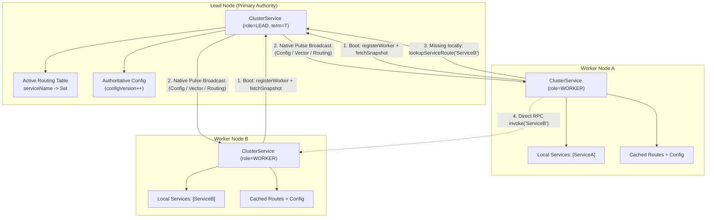

# ADR 0026: Reveila Runtime Cluster Architecture (Zero-Database Self-Healing Fabric)

**Status:** Accepted  
**Date:** November 2026  
**Deciders:** Charles Lee (Founder & Chief Architect)  
**Supersedes / Evolves:** PostgreSQL-coupled cluster sync in [ADR 0010](0010%20Scaling%20Plugins.md) and [ADR 0024](0024%20Databases.md)

---

## 1. Context & Problem Statement

Previously, Reveila's multi-node coordination depended on PostgreSQL `NOTIFY/LISTEN` ([`ClusterSyncService`](../../spring/core/src/main/java/com/reveila/spring/service/ClusterSyncService.java)) and relational tables (`global_settings`, `plugin_registry`) to synchronize state and discover services across nodes. This introduced two architectural constraints:
1. **Infrastructure Coupling:** Running a Reveila cluster required deploying, securing, and maintaining a PostgreSQL daemon even for lightweight or edge/sovereign clusters.
2. **Single Point of Failure & Fire-and-Forget Pub/Sub:** PostgreSQL `NOTIFY/LISTEN` drops notifications for momentarily disconnected nodes and couples cluster liveness to database connectivity.

**Goal:** Build a resilient, self-healing, database-independent **Reveila Runtime Cluster Architecture** as a native Reveila Service (`ClusterService`), while clarifying the role of PostgreSQL in Reveila Enterprise Edition.

---

## 2. Strategic Decision: Decouple Control Plane from Data Plane

| Architectural Plane | Responsibility | Database Dependency |
| :--- | :--- | :--- |
| **Cluster Control Plane** (`ClusterService` in `reveila:core`) | Node membership, Lead/Worker roles, dynamic leader election, active service routing table, native config/event pub-sub ("Pulse"), anti-entropy sync | **Zero DB Dependency** (Pure Kotlin Multiplatform over Reveila RPC) |
| **Enterprise Data Plane** (`spring:core` / `DataService` adapters) | High-concurrency ACID persistence (`audit_logs`, `global_settings`, `plugin_registry`), `PgVectorStore` HNSW million-vector search | **Optional PostgreSQL** in Enterprise Edition (or SQLite/Room on Android, `JsonFileRepository` on Desktop) |

### Answering the PostgreSQL Question
* **Can Reveila achieve cluster-wide state synchronization without PostgreSQL?**  
  **Yes.** By promoting the **Lead Node** to the authoritative state broadcaster and combining **push-based RPC fan-out (`ClusterPulse`)** with **pull-based heartbeat anti-entropy reconciliation (`configVersion` / `routingVersion`)**, Reveila achieves *stronger* consistency than PostgreSQL `NOTIFY/LISTEN` with zero external infrastructure dependencies.
* **Does PostgreSQL still have a role in Enterprise Edition?**  
  **Yes — as an optional Enterprise Data Plane adapter**, not a Control Plane requirement. Enterprise deployments that use PostgreSQL for ACID ledgers and `pgvector` HNSW indexing can optionally enable `cluster.pg.bridge.enabled=true` so database triggers bridge into `ClusterService.publishPulse(...)`, while the cluster itself continues operating seamlessly even if PostgreSQL is absent or offline.

---

## 3. Cluster Topology & Protocols

### 3.1 Node Roles & Bootstrapping
* **Standalone Mode (`system.standalone=true`):** `ClusterService` enters `NodeRole.STANDALONE`; no heartbeats, no elections, and no remote forwarding occur.
* **Cluster Mode (`system.standalone=false`):**
  1. Node probes `cluster.leader.url` and `cluster.seeds`.
  2. If an active **Lead Node** is discovered, the node joins as a **Worker Node**, registers its local services, and applies the initial authoritative `ClusterSnapshot` (config + routing table + peer list).
  3. If **no active Lead Node is reachable**, the starting node automatically initiates `initiateElection()` and claims the **Lead Node** role.

### 3.2 Dynamic Leader Election & Split-Brain Prevention
1. **Trigger:** A Worker detects Lead unreachability for `>= cluster.leader.timeout.ms` (default `10,000ms`), or a non-standalone node boots with no reachable leader.
2. **First-Claim-Without-Rejection (Monotonic Term):**
   * Candidate transitions to `CANDIDATE`, increments `currentTerm`, and broadcasts `ElectionClaim` (`handleLeaderClaim`) to all known peers.
   * Peers reject if `claim.term < currentTerm`, if they already hold `LEAD` at `currentTerm`, if they already voted for another candidate in `claim.term`, or if they have a freshly healthy Lead at `currentTerm`.
   * The **first candidate accepted with zero rejections** promotes to `LEAD` and broadcasts `handleLeaderAnnouncement` so all workers re-register their services and rebuild the routing table.
   * Any rejected candidate adopts the higher term / active Lead URL and steps down to `WORKER`.
3. **Recovered Former Lead Node Verification:**
   * On every Lead maintenance tick (and upon rejoin via `verifyLeadership()`), a Lead Node probes peers.
   * If any peer reports a higher `term` or an active newer leader, the recovered former Lead immediately **steps down to `WORKER`**, registers with the current Lead, and pulls the latest authoritative `ClusterSnapshot`.

### 3.3 Native State Synchronization (Replacing PG `NOTIFY/LISTEN`)
* **Push Path:** `ClusterService.publishConfigUpdate(...)` / `publishPulse(channel, payload, configUpdates)` increments `configVersion` on the Lead Node, applies locally, fires local `ClusterPulseListener` callbacks, and fans out `receivePulse(...)` to all live workers. Worker-initiated mutations are automatically forwarded to the Lead Node.
* **Anti-Entropy Pull Path:** Every `HeartbeatResponse` returns `(term, leaderId, leaderUrl, configVersion, routingVersion)`. If a worker missed a push due to transient disconnection, it detects version lag on its next heartbeat and calls `fetchSnapshot()` to self-heal.

---

## 4. Configuration Properties (`reveila.properties`)

| Property | Default | Description |
| :--- | :--- | :--- |
| `system.standalone` | `true` | Set to `false` to enable cluster mode. |
| `cluster.node.id` | auto-UUID | Unique identifier for this node. |
| `cluster.node.url` | `http://localhost:8080` | Reachable base URL of this node. |
| `cluster.role` | `GENERAL` | Functional workload role (e.g., `FINANCE_WORKER`). |
| `cluster.seeds` | *(empty)* | Comma-separated peer node URLs for discovery & election. |
| `cluster.leader.url` | *(empty)* | Optional initial Lead Node URL. |
| `cluster.heartbeat.interval.ms` | `3000` | Heartbeat & maintenance interval in milliseconds. |
| `cluster.leader.timeout.ms` | `10000` | Lead unreachability timeout before election starts. |
| `cluster.node.timeout.ms` | `15000` | Worker unreachability timeout before Lead evicts routes. |
| `cluster.secret` | *(empty)* | Shared cluster auth token sent in `X-Reveila-Cluster-Token`. |
| `cluster.pg.bridge.enabled` | `false` | Optional Enterprise flag to bridge PG `NOTIFY/LISTEN` into `ClusterService`. |

---

## 5. Key Implementation Files
* [`ClusterModels.kt`](../../reveila/core/src/commonMain/kotlin/com/reveila/cluster/ClusterModels.kt)
* [`ClusterTransport.kt`](../../reveila/core/src/commonMain/kotlin/com/reveila/cluster/ClusterTransport.kt)
* [`ClusterService.kt`](../../reveila/core/src/commonMain/kotlin/com/reveila/cluster/ClusterService.kt)
* [`Reveila.kt`](../../reveila/core/src/jvmMain/kotlin/com/reveila/system/Reveila.kt)
* [`ClusterSyncService.java`](../../spring/core/src/main/java/com/reveila/spring/service/ClusterSyncService.java)
* [`ClusterController.java`](../../spring/core/src/main/java/com/reveila/spring/system/ClusterController.java)
* [`ClusterServiceTest.kt`](../../reveila/core/src/commonTest/kotlin/com/reveila/cluster/ClusterServiceTest.kt)
